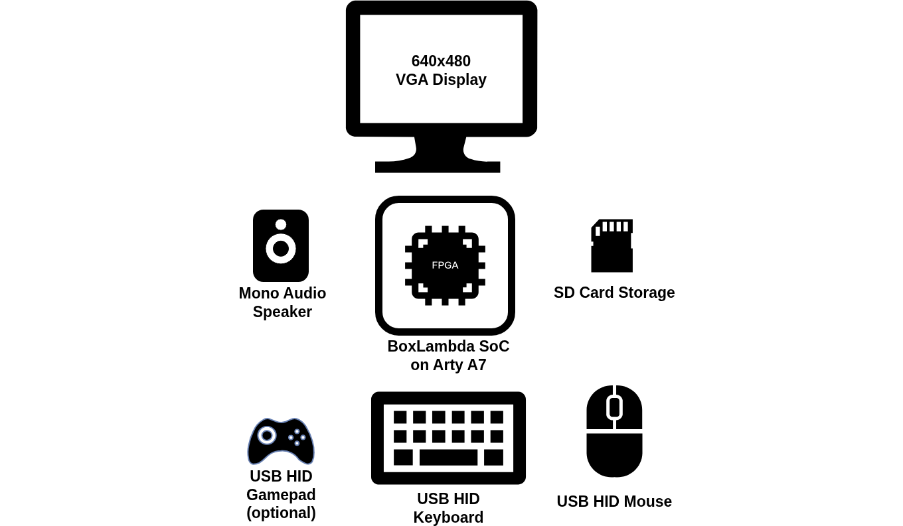
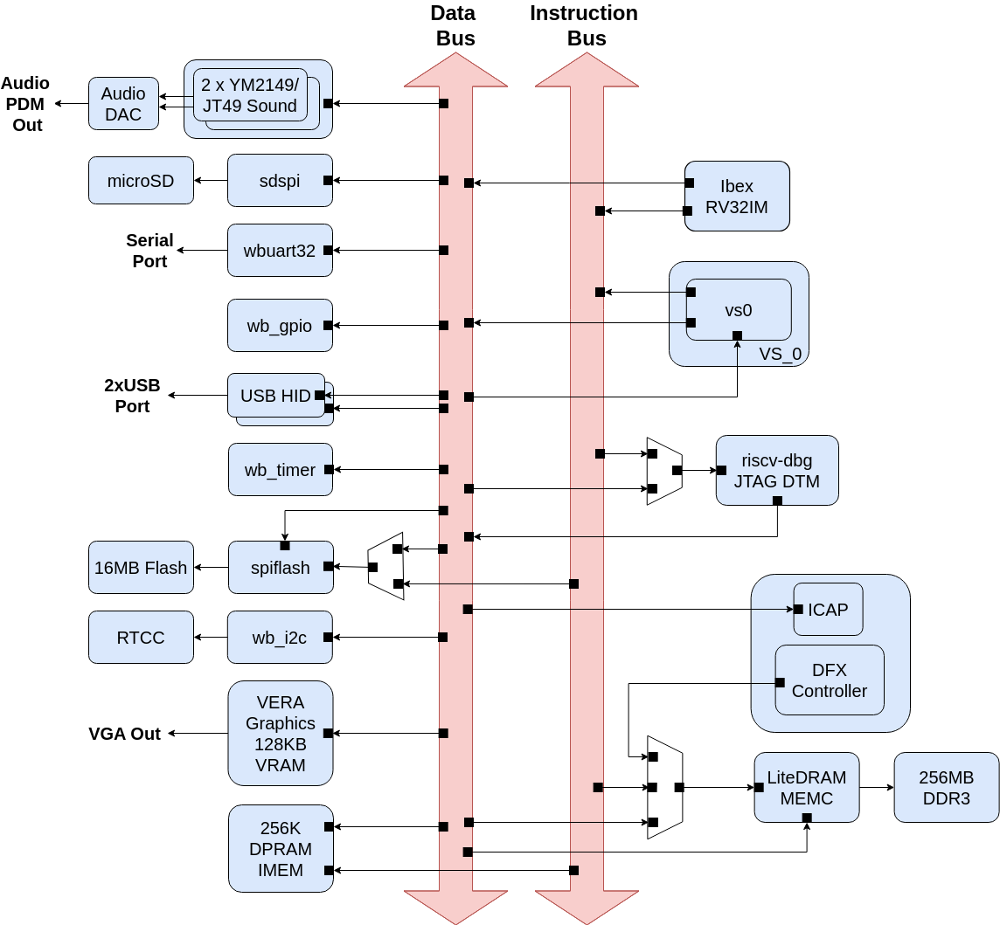
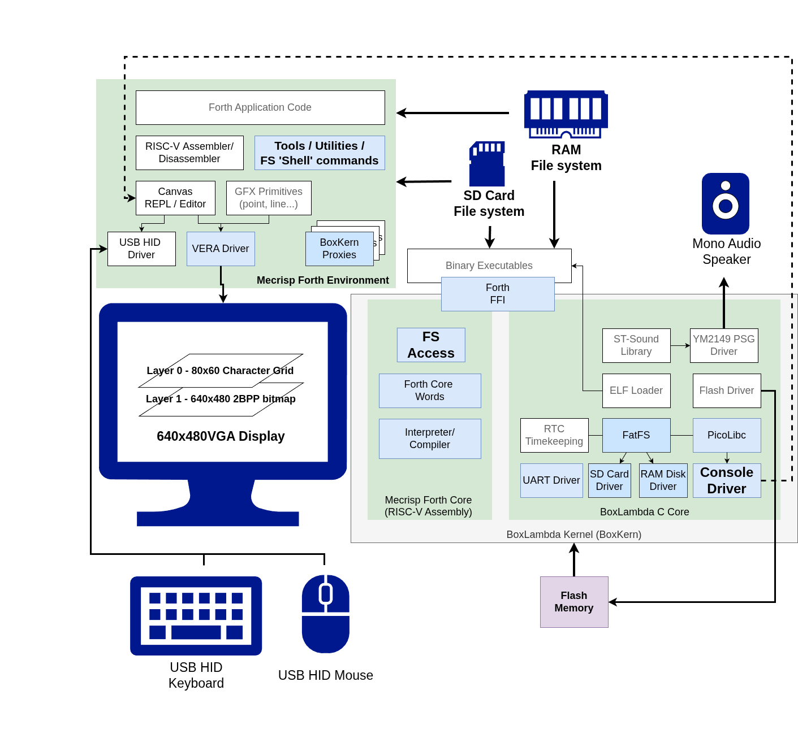

# About BoxLambda

BoxLambda is a hardware-software crossover project creating an experimental,
retro-style, FPGA-based microcomputer. The goal is to create a new computer
to explore old ideas.

## The Physical Setup

*The physical setup.*

## Current Features

- Target FPGA: Arty-A7-100T.
- Ibex RISC-V core with machine timer and hardware interrupt support.
- Harvard architecture-based interconnect.
- Low-latency register and memory access across the SoC.
- Predictable instruction cycle counts.
- DFX Partial FPGA Reconfiguration support (OS support TBD).
- DDR3 external memory access through the Litex memory controller.
- OpenOCD-based debug access on FPGA and Verilator.
- VERA-based VGA graphics: 2 layers, tile or bitmap mode, 2 banks of 64 sprites, 128KB Video RAM, 256 color palette, Forth supported.
- Dual YM2149 PSG Audio (OS support TBD).
- SD Card Controller and FatFs File System.
- 24-pin GPIO, UART, SPI Flash Controller, I2C Controller (OS support TBD).
- Real-time Clock and Calendar support (OS support TBD).
- USB HID Keyboard and Mouse support (OS support TBD).
- SoC test suite covering all components, running on both FPGA and Verilator. 
- Software Test suite covering all OS features, running on FPGA.
- BoxLambda OS: Mecrisp-based Forth software environment with C FFI (WIP).

## Gateware Block Diagram

## Software Block Diagram

*BoxLambda OS Architecture Block Diagram.*

## Key Goals

- Create a sandbox for experimenting with software and FPGA gateware:
  - It should be **easy** to jump in and do something: create, hack, tinker.
    - **Simple Enough for One Person**: A motivated individual can develop a solid understanding of the entire system, including software and hardware.
    - **Deterministic Behavior**: The duration of operations such as internal memory or register access must be predictable by design.
    - **Self-Contained Run-Time Environment** supporting high-level interactive and low-level systems programming.
  - Create a **Modular Architecture** that allows software and hardware components to be mixed and matched, with optional support for FPGA Partial Reconfiguration.
- Target Hardware: Digilent's [Arty-A7](https://digilent.com/reference/programmable-logic/arty-a7/start).

- The computer supports the following peripherals:
  - USB HID Keyboard
  - USB HID Mouse (optional)
  - USB HID Joystick (optional)
  - Real-Time Clock and Calendar (optional)
  - Serial port
  - SD card storage
  - Flash Memory storage
  - VGA Display
  - Audio output

- Sound and graphics support retro-style 2D demos and gameplay.

## Status (October 2026)

- **Infrastructure** (build system, etc.): Complete.
- **Gateware**: Complete and meeting requirements.
- **Software**: Development ongoing.
  - **BoxLambda OS Forth Environment**: Development ongoing.
  - **Forth<->C FFI**: completed.
  - **Filesystem layer**: completed.
  - **Graphics layer**: completed.

## Changelog

- [Changelog](CHANGELOG.md)

## Links

- **Repo**: [https://github.com/epsilon537/boxlambda/](https://github.com/epsilon537/boxlambda/)
- **Blog**: [https://epsilon537.github.io/boxlambda/](https://epsilon537.github.io/boxlambda/)
- **v0.5.0**: [https://github.com/epsilon537/boxlambda/tree/v0.5.0](https://github.com/epsilon537/boxlambda/tree/v0.5.0)

## Documentation

- [Start Here](https://boxlambda.readthedocs.io/en/v0.5.0/start-here/)
- [Full Documentation Index](https://boxlambda.readthedocs.io/en/v0.5.0/full-index/)
