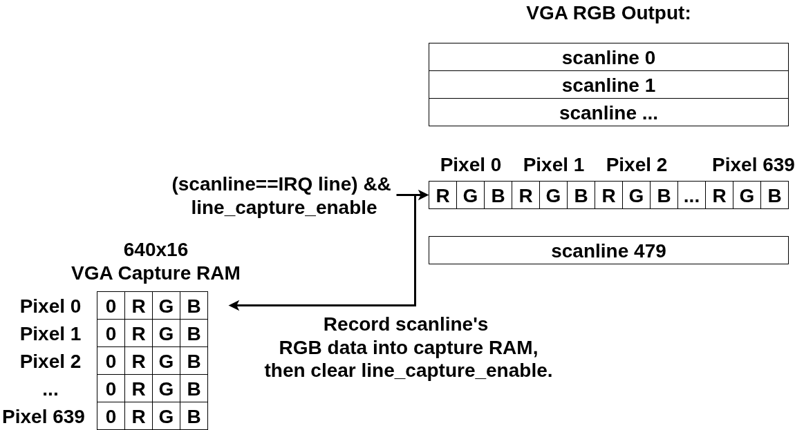

BoxLambda now has software support for the [VERA graphics subsystem](https://epsilon537.github.io/boxlambda/integrating-vera/). The new `vera.fs` driver and `font-loader.fs` module bring the project another step closer to its goal of becoming a self-contained microcomputer.

Developing the driver also led to improvements elsewhere in the OS, including module support, runtime checks, and a Fast Boot procedure.

This post introduces the graphics API, shows it in action, and discusses some of the supporting changes that made development easier.

# Demos

Here are a few examples showing the VERA module in action. I'll explain the architecture and API afterwards.

The clips and screenshot below are captured from BoxLambda's VGA output.

## Lissajous

The following little demo creates a Lissajous curve animation. The horizontal and vertical frequences can be adjusted through keyboard controls.
Run the following command from the Forth prompt to start the demo:



Source: [lis-demo.fs](https://github.com/epsilon537/boxlambda/blob/v0.5.0/fs/demo/lis-demo.fs)

To run this demo, execute the following command from BoxLambda's Forth prompt:

```
include demo/forth/lis-demo.fs
```

## Text Mode

This example could be the beginning of an editor. It sets up a 40x30 text grid using an 8x8 font and lets the user enter text. A sprite is used to display the cursor position.



Source: [VERA Text Mode Demo](https://github.com/epsilon537/boxlambda/blob/v0.5.0/fs/demo/vera-txt-demo.fs)

To run this demo, execute the following command from BoxLambda's Forth prompt:

```
include demo/forth/vera-txt-demo.fs
```

## Palette

The palette demo is a static, grid-based rendering of VERA's color palette:

[](../assets/forth-vera-gfx-driver/vera-pal-demo.png)

Source: [VERA Palette Demo](https://github.com/epsilon537/boxlambda/blob/v0.5.0/fs/demo/vera-pal-demo.fs)

To run this demo, execute the following command from BoxLambda's Forth prompt:

```
include demo/forth/vera-pal-demo.fs
```

# Context

The diagram below illustrates the software architecture I am working towards for the BoxLambda OS.

[](../assets/forth-vera-gfx-driver/BoxLambda-OS-Architecture-Vera-Focus.png)

*BoxLambda OS Architecture. Click to zoom.*

This post specifically focuses on the **yellow boxes**.

For a broader overview of BoxLambda's goals and current feature set, [see the About page](../about/).

# VERA Graphics Driver Concepts

The VERA Forth Module is designed around the following concepts:

- **Sheets:** Objects that hold pixel data in VRAM. A sheet can represent either a tileset or a bitmap.
  - **Tilesets** contain a collection of tiles, such as a font or sprite sheet. Configure them using `sheet-tileset{}`.
  - **Bitmaps** hold a screen-wide pixel image. Configure them using `sheet-bitmap{}`.
- **Pixels:** The `pxl{}` API reads or writes individual pixels in a sheet.
- **Tilemaps and map entries:** A tilemap defines a grid of map entries. Each entry specifies which tile to display and its associated attributes. Configure tilemaps using `tmap{}` and access individual entries using `mapentry{}`.
- **Sprites:** Movable graphics objects that reference tiles in a tileset for their pixel data. Configure them using `spr{}`.
- **Layers:** VERA provides two graphics layers, `l0` and `l1`. Each can operate in tilemap or bitmap mode. The `layer{}` API configures their properties.

[](../assets/forth-vera-gfx-driver/vera-module-concepts.png)

*VERA Graphics Driver Concepts.*

## Palette Groups

VERA has a 256-entry color palette, divided into 16 palette groups of 16 colors each.

Depending on the pixel depth, a pixel stores a color index using 2, 4, or 8 bits. Color index 0 is transparent. Indices 1–15 are interpreted relative to the selected palette group, while indices 16–255 refer directly to the global palette.

The palette group is selected through the map entry, sprite, or bitmap-layer configuration.

[](../assets/forth-vera-gfx-driver/vera-pal-group-refs.png)

*Palette Groups referenced from sprites, map entry and bitmap mode layers.*

This is the default palette:

[](../assets/forth-vera-gfx-driver/default-palette.png)

*The Default Palette (click to zoom).*

The individual palette groups are 12-bit RGB versions of their namesakes on [https://lospec.com/palette-list](https://lospec.com/palette-list). Thanks to Matthias Koch for the tip.

## Z-Depth and Transparency

Pixels set to color index 0 are transparent.

If both layers are enabled, Layer 1 sits in front of Layer 0. Sprites can be positioned in front of or behind a given layer using their *z-depth* attribute, as illustrated in the following diagram:

[](../assets/forth-vera-gfx-driver/vera-z-depth.png)

*Z-Depth.*

- `SPR-L1`: position the sprite in front of Layer 1.
- `SPR-L0-L1`: position the sprite between Layer 0 and Layer 1.
- `SPR-BG-L0`: position the sprite between the background and Layer 0.
- `SPR-DIS`: position the sprite behind the background, i.e., disable the sprite.

# VERA Graphics Words

Source: [vera.fs](https://github.com/epsilon537/boxlambda/blob/v0.5.0/fs/forth/boxkern-includes/vera.fs) 

See the [VERA Graphics documentation page](https://boxlambda.readthedocs.io/en/v0.5.0/software/boxlambda-os/vera/#words) for a complete description of all VERA-related Words. This section highlights some of the more important Words by example.

- Tile Maps:

    ```
    <tmap> tm
    tm tmap{ 64 width 32 height TMAP-TXT16 type }apply
    ```

    Instantiates a tilemap object and configures it.

- Map Entry:

    ```
    tm mapentry{ 0 tidx 10 20 vec2 xy YELLOW fg BLACK bg }apply
    ```

    Sets the tilemap entry at column 10, row 20 to tile index 0, a yellow foreground and a black background.

- Sheets:

    ```
    <sheet-tileset> ts
    ts sheet{ 8 width 8 height 1 bpp 256 tiles }apply
    ```

    Instantiates a tileset object and configures it: 256 8x8 tiles with a color depth of 1 bpp.

    ```
    <sheet-bitmap> bm
    bm sheet{ 320 width 240 height 1 bpp }apply
    ```

    Instantiates a bitmap object and configures it: dimensions 320x240 and a color depth of 1 bpp.

- Pixels:

    ```
    ts pxl{ 2 tidx WHITE color 3 2 vec2 xy }apply
    ```

    In the tileset, tile 2, sets the pixel in row 2, column 3 to color index `WHITE`.

    ```
    bm pxl{ BLACK color 100 200 vec2 xy }apply
    ```

    In the bitmap, sets the pixel at x=100/y=200 to color index `BLACK`.

- Sprites:

    ```
    0 <spr> spr0
    spr0 spr{ 20 30 xy SPR-L0-L1 z 2 tidx ts sheet }apply
    ```

    Instantiates sprite 0, positions it on the screen at x=20/y=30, renders it between Layers 0 and 1, taking the pixel data from tile 2 in the `ts` tilesheet.

- Layers:

    ```
    tm ts l0 layer-tilemap-mode
    ```

    Configures layer 0 in tilemap mode using the previously configured `tm` tilemap and `ts` tilesheet objects.

    ```
    bm l1 layer-bitmap-mode
    ```

    Configures layer 1 in bitmap mode using the previously configured `bm` bitmap object.

## Parameter Blocks

The VERA API uses *parameter blocks* to configure graphics objects. They let you specify attributes by name, in any order, rather than having to remember the order of values on the data stack.

For example:

```forth
<sheet-tileset> ts
ts sheet{ 8 width 8 height 1 bpp 256 tiles }apply
```

Here, `ts` is a tileset sheet object. The `sheet{...}apply` parameter block configures it as a collection of 256 8×8 tiles with one bit per pixel.

Because the attributes are named, their order doesn't matter. The following is equivalent:

```forth
ts sheet{ 256 tiles 8 height 8 width 1 bpp }apply
```

Parameter blocks also support incremental configuration. `}set` records attributes in the object without applying them to the hardware; `}apply` commits the configuration.

### Lexical Scoping and the Module API

Parameter blocks use attribute Words such as `width` and `height` to configure different kinds of objects.

```forth
tm tmap{ 64 width 32 height TMAP-TXT16 type }apply
ts sheet{ 8 width 8 height 1 bpp 256 tiles }apply
```
The [Module API](https://github.com/epsilon537/boxlambda/blob/v0.5.0/fs/forth/boxkern-includes/module.fs) provides the scoping mechanism that allows these names to be reused without clashing.

Example Usage of the Module API:

```
begin-module module-a
  : foo ." module-a foo" cr ;
end-module

begin-module module-b
  : foo ." module-b foo" cr ;
end-module

module-a :: foo \ executes module-a's foo.
module-b :: foo \ executes module-b's foo.

module-a import
foo \ executes module-a's foo.
module-a unimport

module-b import
foo \ executes module-b's foo.
module-b unimport
```

# The VERA Font Loader

Source: [font-loader.fs](https://github.com/epsilon537/boxlambda/blob/v0.5.0/fs/forth/font-loader.fs)

`load-font ( tileset filename-addr filename-len --  #glyphs )`

The font loader reads an 8×8, 1-bpp font from a text file and loads it into a VERA tileset.

Font files look like this:

```
...
# $21 ASC: $41 'A'

..**....
..*.*...
..*..*..
..****..
..*..*..
..*..*..
..*..*..
........

# $22 ASC: $42 'B'

..**....
..*.*...
..*..*..
..***...
..*..*..
..*..*..
..****..
........

...
```

The text-based format is easy to edit by hand. Each glyph is represented by eight rows of eight characters, with `*` marking a set pixel.

I also wrote a conversion script for fonts from DamienG's [ZX Origins](https://damieng.com/typography/zx-origins/) collection. Here are a few examples included with BoxLambda:

- [altered-chrome.fnt](https://github.com/epsilon537/boxlambda/blob/v0.5.0/fs/demo/altered-chrome.fnt).
- [district-digital.fnt](https://github.com/epsilon537/boxlambda/blob/v0.5.0/fs/demo/district-digital.fnt).
- [night-in-tokyo.fnt](https://github.com/epsilon537/boxlambda/blob/v0.5.0/fs/demo/night-in-tokyo.fnt).

## An Example Program

This is the source code of the Lissajous demo shown earlier, with the keyboard controls removed for simplicity's sake:

```
320 constant XRES
240 constant YRES

<sheet-bitmap> bitmap0
<sheet-bitmap> bitmap1

create sin-table \ 256 cells
0  , 2  , 5  , 7  , 10  , 12  , 15  , 17  , ...

0 variable x
0 variable y
$10000 variable xf \ x frequency
$10000 variable yf \ y frequency
64 variable ph \ phase difference between x and y.
0 variable bitmapptr \ toggle for rendering to bitmap 0 or 1 for double buffering.

\ The main loop, invoked from list-demo below.
( -- )
: drawloop
  begin
    \ double buffering toggle
    bitmapptr dup @ bitmap0 = if ( bitmapptr )
      bitmap1 else bitmap0
    then ( bitmapptr bitmap )
    swap !

    bitmapptr @ sheet-base@ bitmapptr @ sheet-size@ 0 fill \ Erase the bitmap

    \ Draw 256 points
    ph @
    256 0 do
      \ sin(i*xf), modulo 256 to wraparound the sin-table
      i xf @ * 16 rshift 255 and cells sin-table + @ 160 + ( ph x )
      \ sin((i*yf+ph))
      over i yf @ * 16 rshift + 255 and cells sin-table + @ 120 + ( ph x y )
      vec2 ( ph vec2 )
      bitmapptr @ pxl{ ( vec2 ) xy }apply ( ph )
    2 +loop
    drop ( )
 
    \ Increment phase to create an animation.
    ph @ 1 + 255 and ph !

    \ Double buffer switch.
    begin scanline@ 470 >= until
    bitmapptr @ l0 layer-bitmap-mode

  again
;

\ Demo entry point
( -- )
: lis-demo

  bitmap0 sheet{ XRES width YRES height 1 bpp }apply \ bitmap0 for double buffering.
  bitmap0 pxl{ WHITE color }set \ Set pixel color to white
  bitmap1 sheet{ XRES width YRES height 1 bpp }apply \ bitmap1 for double buffering.
  bitmap1 pxl{ WHITE color }set \ Set pixel color to white
  bitmap0 sheet.
  bitmap1 sheet.
  bitmap0 l0 layer-bitmap-mode

  true l0 layer-enable
  false sprites-enable

  $40 dup hscale! vscale! \ scale to 320x240

  true display-enable

  $10000 xf ! \ .16 fixed point
  $10000 yf !

  drawloop
;

lis-demo
```
The demo uses double buffering with two bitmap objects. While one bitmap is displayed, the program draws the next frame into the other. It then switches the displayed bitmap shortly after scanline 470, outside the visible portion of the frame, to avoid screen tearing.

# VGA line capture

To support automated graphics testing, I added a VGA line-capture mechanism to the VERA graphics core.

Software selects a scanline by writing its line number to a Wishbone register and enables capture. The hardware records the RGB pixel data for that scanline in a 640-pixel-wide memory region that software can read back.

This makes it possible to test the actual VGA output produced by the FPGA, rather than relying solely on software-level tests.



*VERA VGA Line Capture.*

Here is a code fragment using the VGA line capture API:

```
1 irqline! \ Capture VGA scanline 1
true line-capture-enable
begin line-capture-enabled? not until
0 line-capture-pxl@ hex. cr \ Print the RGB value of captured scanline 1, pixel 0
1 line-capture-pxl@ hex. cr \ Print the RGB value of captured scanline 1, pixel 1
```

# Supporting Features

Implementing the graphics driver exposed some limitations in the Forth development environment. I added runtime checks to catch errors earlier and improved startup time with a precompiled Forth image. These changes are useful beyond the graphics driver.

## Runtime Checking

Forth doesn't have a conventional static type system or compiler-enforced stack effects. The [run-time-checking.fs](https://github.com/epsilon537/boxlambda/blob/v0.5.0/fs/forth/boxkern-includes/run-time-checking.fs) module adds checks that catch some common programming errors while the code is running.

When a check fails, an exception is raised. The Forth REPL reports the offending Word, making errors easier to track down.

```
sd0:/demo> <sheet-bitmap> bm
sd0:/demo> <sheet-tileset> ts
sd0:/demo> bm sheet{ 8 width 160 height 1 bpp }apply
***Uncaught Exception***
Raised by: ( 28031070 + 00000098 ) sheet-params :: width
Assert failed!
```

- **Assert Blocks**:

    `xassert{ <this-must-be-true> }xassert`

    Put an assert statement between `xassert{ ... }xassert`. Any number of statements can be put between the { }, but they must end with a flag. If the flag is false, an `x-assert` exception is raised. `xassert{...}xassert` blocks are compiled out if `xassert-enable` is set to 0.

- **Struct Typechecking**: Usage example:

    ```
    begin-structure tilemap-struct
      field:  .base
      hfield: .width
      hfield: .height
      cfield: .type
    end-structure

    typechecker tm-typecheck

    \ Initialize the tilemap object.
    \ ( tilemap -- )
    : init 
      dup tilemap-struct 0 fill
      init-type tm-typecheck
    ;

    \ Retrieve map width from the tilemap object.
    \ ( tilemap -- width )
    : width@
      tm-typecheck \ print message with wordname/location if typecheck fails.
      .width h@ ;
    ```

- **Stack Checking:**

    ```
    ( n1 n2 -- n3 )
    : foo
      [ 2 1 stack-checker ]
      ...
    ;
    ```

    For example, in execution mode create a `stack-checker` instance and specify the number of input and output params. If, after the stack-checked Word has executed, the stack doesn't have the expected depth, a failure will be reported and execution stops.

## Fast Boot

During OS boot, if *Fast Boot* is enabled (controlled by a board switch), a precompiled **boxkern forth image** (`boxkern_forth_img`) is copied into place, instantly populating the Forth dictionary with all the Words from the [boxkern-includes](https://github.com/epsilon537/boxlambda/blob/v0.5.0/fs/forth/boxkern-includes/boxkern-includes.fs) modules list.


*The BoxLambda OS Fast Boot Sequence.*

See [here](https://boxlambda.readthedocs.io/en/v0.5.0/software/boxlambda-os/top-level-and-boot-seq/) for a full description of the OS boot procedure.

*Fast Boot* cuts down on the boot time dramatically:

- **Slow Boot Time** (compiles all Forth code from source at boot time): 64 seconds.
- **Fast Boot Time** (installs precompiled dictionary):  5 seconds.

# Conclusion

Settling on the VERA graphics API took considerable experimentation and iteration. Forth's minimal syntax makes it possible to experiment freely with API designs, but that flexibility also means there are more decisions to make, and more opportunities to take a wrong turn.

I'm happy with where the API has landed. With graphics support in place, BoxLambda is another step closer to becoming a self-contained microcomputer.

Next, I'll add USB keyboard and mouse support. That will clear the way for a terminal and editor, bringing the system closer to a point where it can be used to develop software on itself.

