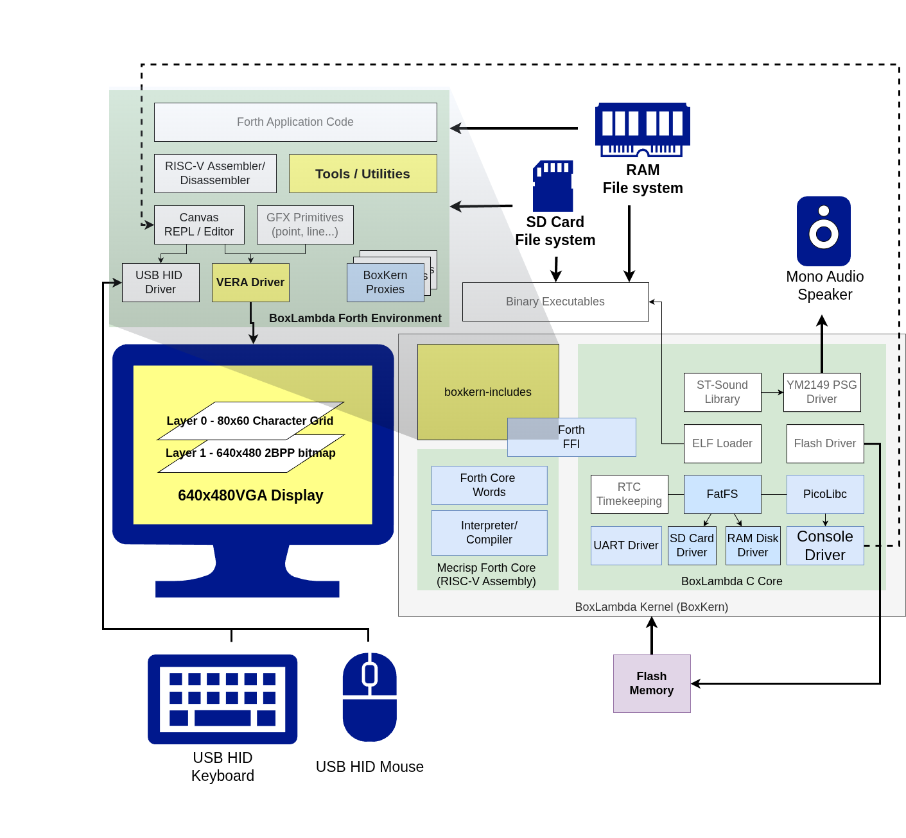
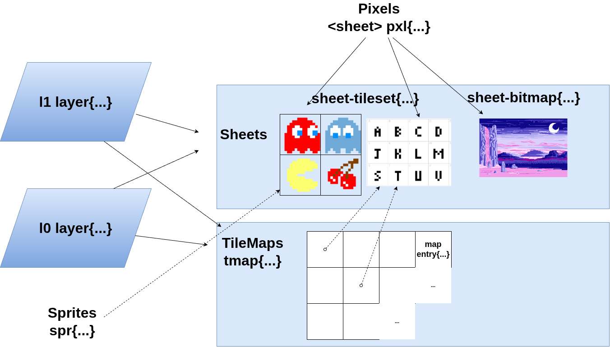
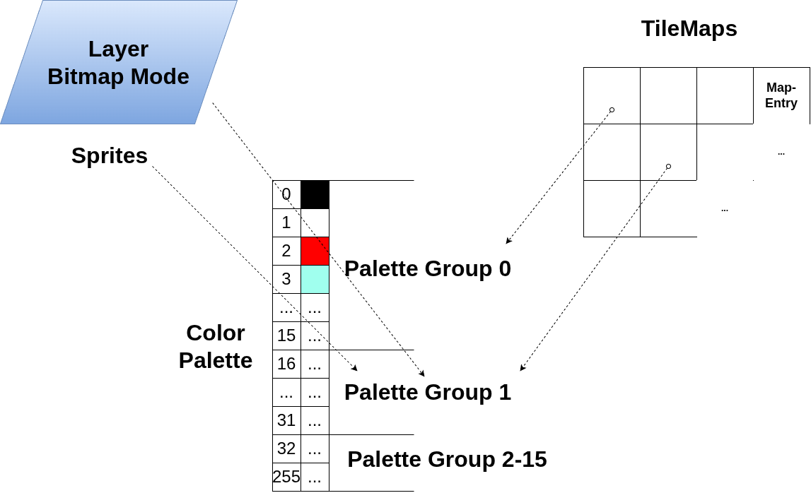
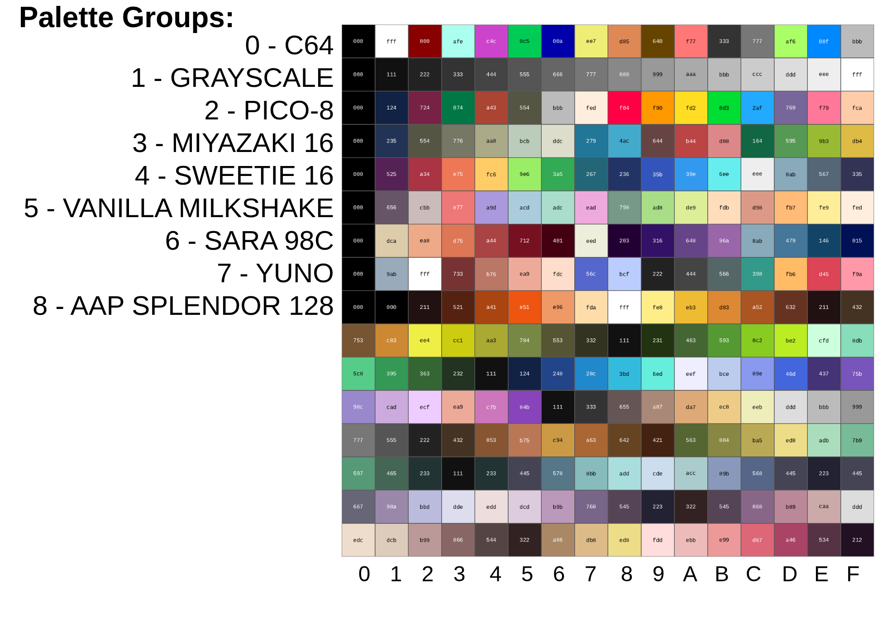
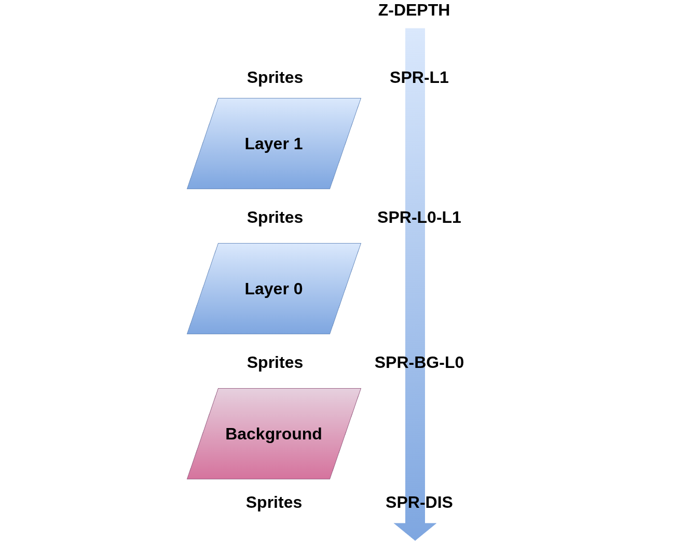
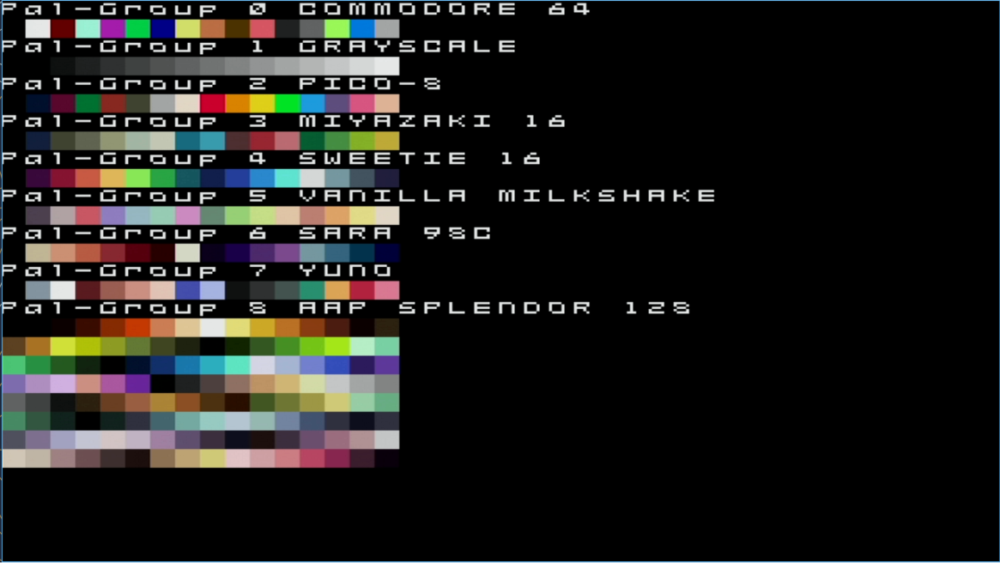

BoxLambda finally has software support for the VERA graphics subsystem. The `vera.fs` and `font-loader.fs` modules bring BoxLambda a step closer to the immediate goal of achieving self-contained operation. To support the VERA driver development, new language features were added such *namespace/module support* and *run-time checking*. To improve turn-around time, the OS now also supports a *Fast Boot* procedure.

# Context

The diagram below illustrates the software architecture I am working towards for the BoxLambda OS.

[](../assets/forth-vera-gfx-driver/BoxLambda-OS-Architecture-Vera-Focus.png)

*BoxLambda OS Architecture. Click to zoom.*

This post specifically focuses on the **yellow boxes**.

For a broader overview of BoxLambda's goals and current feature set, [see the About page](../about/).

# VERA Graphics Driver Concepts

The VERA Forth Module is designed around the following concepts:

- **Sheets**: Sheets hold pixel data in VRAM. There are two types of sheets:
    - **Tilesets**: The sheet is subdivided into a number of tiles, e.g., a font or a sprite sheet. Tilesets are configured using the `sheet-tileset{}` API.
    - **Bitmaps**: The sheet is a screen-wide bitmap. Bitmaps are configured using the `sheet-bitmap` API.
- **Pixels**: The pixel API, `pxl{}`, is used to set or get pixels in a sheet.
- **Tilemaps** and **MapEntries**: A Tilemap divides the screen into a grid of *MapEntries*. Each MapEntry in this grid references a specific tile in a tileset (e.g., by its ASCII character code). Tilemaps are configured with the `tmap{}` API. MapEntries are accessed using the `mapentry{}` API.
- **Sprites**: Movable objects. Sprites are associated with tiles in a tilesheet for their pixel data. Sprites are manipulated with the `spr{}` API.
- **Layers**: VERA has two layers, `l1` and `l0`. Each layer can be configured in *tilemap mode* or *bitmap mode*. When in tilemap mode, the layer is associated with a tilemap and tileset sheet. When in bitmap mode, the layer is associated with a bitmap sheet. Layers are configured using the `layer{}` API.

[](../assets/forth-vera-gfx-driver/vera-module-concepts.png)

*VERA Graphics Driver Concepts.*

## Palette Groups

VERA divides the 256-color palette into 16 Palette Groups of 16 colors each.
Pixels have a color index of either 0-3 (2bpp), 0-15 (4bpp), 0-255 (8bpp). This color index is processed using the following logic:

  - Color indices 0 (transparent) and 16-255 are palette-absolute.
  - Color indices 1-15 are relative to the selected palette group.

The palette group to use is specified as a [mapentry](#map-entry), [sprite](#sprites), or [bitmap sheet](#sheets) attribute.

[](../assets/forth-vera-gfx-driver/vera-pal-group-refs.png)

*Palette Groups referenced from sprites, mapentries and bitmap mode layers.*

This is the default palette:

[](../assets/forth-vera-gfx-driver/default-palette.png)

*The Default Palette (click to zoom).*

The individual palette groups are 12-bit RGB versions of their namesakes on [https://lospec.com/palette-list](https://lospec.com/palette-list). Thanks to Matthias Koch for the tip.

## Z-Depth and Transparency

Pixels set to color index 0 are transparent.

If both layers are enabled, Layer 1 sits in front of Layer 0. Sprites can be positioned in front of or behind a given layer using their *z-depth* attribute, as illustrated in the following diagram:

[](../assets/forth-vera-gfx-driver/vera-z-depth.png)

*Z-Depth.*

- `SPR-L1`: position the sprite in front of Layer 1.
- `SPR-L0-L1`: position the sprite between Layer 0 and Layer 1.
- `SPR-BG-L0`: position the sprite between the background and Layer 0.
- `SPR-DIS`: position the sprite behind the background, i.e., disable the sprite.

## Parameter Blocks

The VERA module API relies heavily on *Parameter Blocks* to configure the attributes of objects. Here's an example:

```
<sheet-tileset> ts
ts sheet{ 8 width 8 height 1 bpp 256 tiles }apply
```

Here `ts` is a tileset sheet object and `sheet{...}apply` is the parameter block used to configure the tileset sheet.
The attributes within a parameter block can be specified in any order. The following two lines are equivalent:

```
ts sheet{ 8 width 8 height 1 bpp 256 tiles }apply
ts sheet{ 256 tiles 8 height 8 width 1 bpp }apply
```

Forth being stack oriented, this statement...

`ts sheet{ 8 width 8 height 1 bpp 256 tiles }apply`

...is equivalent to this statement:

`ts 256 1 8 8 sheet{ width height bpp tiles }apply`

Attributes can also be specified incrementally using `}set` followed by `}apply`:

```
ts sheet{ 8 width 8 height }set
ts sheet{ 1bpp }set
ts sheet{ 256 tiles }apply
```

`}set` records the given attributes in the object, `}apply` commits them to VERA hardware.

# VERA Graphics Words

[vera.fs](https://github.com/epsilon537/boxlambda/blob/v0.5.0/fs/forth/boxkern-includes/vera.fs) 

See the [VERA Graphics documentation page](https://boxlambda.readthedocs.io/en/latest/software/boxlambda-os/vera/#words) for a complete description of all VERA-related Words. This section highlights some of the more important Words.

### Tile Maps

A tilemap is a grid of tiles, characterized by its width, height, and tile type. The grid is populated using the `mapentry{...}` API described in the next subsection.

`<tmap> tmap{ <width> width <height> height <type> type }apply`  
`<tmap> tmap{ <width> width <height> height <type> type }set`

- A tilemap parameter block. The `<...>` items indicate what type of value is expected on the top of the stack at this point, to be consumed by the following Word.
    - `<tmap>`: A tilemap object.
    - `<width>`: The tilemap width: 32, 64, 128 or 256.
    - `<height>`: The tilemap height: 32, 64, 128 or 256.
    - `<type>`: The tilemap type:
        - `TMAP-TXT16`: 16 color foreground 16 color background text mode.
        - `TMAP-TXT256`: 256 color foreground single color background text mode.
        - `TMAP_TILE`: tile mode.

    `}apply ( -- )` ends a tilemap parameter block and (re)allocates VRAM for this tilemap to accommodate the given width and height.
    If VRAM was previously allocated for this tilemap, this VRAM will be released before reallocating VRAM.  

    `}set ( -- )` ends a tilemap parameter block and records the given tilemap parameters in the tilemap object, but doesn't apply the parameters yet. Useful when setting parameters piecemeal.

`<tmap> ( "name" -- )`

- Create and initialize a tilemap object.

### Map Entry

The Mapentry API is used to enter characters/tiles, along with their attributes, in a tilemap grid.

`<tmap> mapentry{ <bg> bg <fg> fg <tidx> tidx <pal-group> pal-group <flip> flip <vec2> xy }apply`  
`<tmap> mapentry{ <bg> bg <fg> fg <tidx> tidx <pal-group> pal-group <flip> flip <vec2> xy }set`  
`<tmap> mapentry{ <vec2> xy }get`

- A mapentry parameter block. The `<...>` items indicated what type of value is expected on
  the top of the stack at this point, to be consumed by the following Word.
  - `<tmap>`: A tilemap object.
  - `<bg>`: Background color palette index. 0..15. Only used in 16 color text mode.
  - `<fg>`: Foreground color palette index.
    - 0..255 in 256 color text mode.
    - 0..15 in 16 color text mode.
    - Not used in tile mode.
  - `<tidx>`: Index of the tile to draw at this mapentry position.
  - `<pal-group>`: Palette group. 0..15. Only used in tile mode. See [Palette Groups](#palette-groups).
  - `<flip>`: Flip tile: `VFLIP`, `HFLIP`, `VFLIP_HFLIP` or 0.
  - `<vec2>`: The column and row position of the mapentry, specified as a vec2 object. See [2D Vectors](forth-generic/vec2.md).

  `}apply ( -- )` ends a mapentry parameter block and applies the mapentry as specified.

  `}set ( -- )` ends a mapentry parameter block and records the given mapentry parameters in the tilemap object, but doesn't apply the parameters yet. Useful when setting parameters piecemeal.

  `}get ( -- )` ends a mapentry parameter block. Read from VRAM the specified mapentry location
  and decode it, populating fg, bg, pal-group, flip attributes. This is useful for mapentry read-modify-write operations.

### Sheets

A *Sheet* object can hold a *Tileset* (e.g. a font or sprite sheet) or a single *Bitmap* (a display-wide image).

`<tileset> sheet{ <width> width <height> height <bpp> bpp <#tiles> tiles }apply`
`<tileset> sheet{ <width> width <height> height <bpp> bpp <#tiles> tiles }set`
`<bitmap> sheet{ <width> width <height> height <bpp> bpp }apply`
`<bitmap> sheet{ <width> width <height> height <bpp> bpp }set`

- A sheet parameter block. The `<...>` items indicated what type of value is expected on
  the top of the stack at this point, to be consumed by the following Word.
  - `<tileset>`: A tileset sheet object.
  - `<bitmap>`: A bitmap sheet object.
  - `<width>`: The tile width:
    - 8 or 16 for regular tiles.
    - 8, 16, 32 or 64 for sprites.
    - 320 or 640 for bitmaps.
  - `<height>`: The tile height:
    - 8 or 16 for regular tiles.
    - 8, 16, 32 or 64 for sprites.
    - 1..4095 for bitmaps.
  - `<bpp>`: Bits per pixel:
    - 1, 2, 4 or 8 for regular tiles and bitmaps.
    - 4 or 8 for sprites.
  - `<#tiles>`: The number of tiles in the tileset. 0..1023. Not used in case of bitmaps.

  `}apply ( -- )` ends a sheet parameter block and (re)allocates VRAM for this sheet to accommodate #tiles, bpp, width and height.
  If VRAM was previously allocated for this sheet, this VRAM will be released before reallocating VRAM.

  `}set ( -- )` ends a sheet parameter block and records the given sheet parameters in the sheet object, but doesn't apply the parameters yet. Useful when setting parameters piecemeal.

`<sheet-bitmap> ( "name" -- )`

- Create and initialize a bitmap sheet object.

`<sheet-tileset> ( "name" -- )`

- Create and initialize a tileset sheet object.

### Pixels

`<tileset> pxl{ <tidx> tidx <color> color <vec2> xy }apply`
`<tileset> pxl{ <tidx> tidx <color> color <vec2> xy }set`
`<tileset> pxl{ <tidx> tidx <vec2> xy }get`
`<bitmap> pxl{ <color> color <vec2> xy }apply`
`<bitmap> pxl{ <color> color <vec2> xy }set`
`<bitmap> pxl{ <vec2> xy }get`

- A pixel parameter block. The <...> items indicated what type of value is expected on
  the top of the stack at this point, to be consumed by the following Word.
  - `<tileset>`: A tileset sheet object.
  - `<bitmap>`: A bitmap sheet object.
  - `<tidx>`: Index of the tile in the tileset sheet. `0..num_tiles-1.`
  - `<color>`: The pixel color palette index.
  - `<vec2>`: The pixel position in the tile, specified as a vec2. See [2D Vectors](forth-generic/vec2.md).

  `}apply ( -- )` ends a pixel parameter block and draw the pixel in the tile as specified.

  `}set ( -- )` ends a pixel parameter block and records the given pixel parameters in the sheet object, but doesn't apply the parameters yet. Useful when setting parameters piecemeal.

  `}get ( -- color )` ends a pixel parameter block. Returns the pixel color from the given position within the tile or bitmap.

`pxl-params-apply ( sheet -- )`

- Apply the pixel parameters previously recorded in a pxl{...}set block.

### Sprites

`<spr> spr{ <vec2> xy <flip> flip <z> z <colmask> colmask <pal-group> pal-group <tidx> tidx <tileset> sheet }apply`
`<spr> spr{ <vec2> xy <flip> flip <z> z <colmask> colmask <pal-group> pal-group <tidx> tidx <tileset> sheet }set`

- A sprite parameter block. The `<...>` items indicated what type of value is expected on
  the top of the stack at this point, to be consumed by the following Word.
  - `<spr>`: A sprite object
  - `<vec2>`: The sprite position in the tile, specified as a vec2. See [2D Vectors](forth-generic/vec2.md).
  - `<flip>`: Flip the sprite: `VFLIP`, `HFLIP`, `VFLIP_HFLIP` or 0.
  - `<z>`: The sprite's z-depth. See section [Z-Depth and Transparancy](#z-depth-and-transparency).
      - `SPR-DIS` : Disable the sprite (or, if you will, position it behind the background).
      - `SPR-BG-L0` : Position sprite between background and Layer 0.
      - `SPR-L0-L1` : Position sprite between Layer 0 and Layer 1.
      - `SPR-L1`: Position sprite in front of layer 1.
  - `<colmask>`: Set the sprite collision mask.
  - `<pal-group>`: The sprite's palette group id. See [Palette Groups](#palette-groups).
  - `<tidx>`: Index of the tile in the sheet containing the sprite's pixel data.
  - `<tileset>`: A tileset sheet object.

  `}apply ( -- )`: Commit the sprite's attributes to hardware, i.e. to the sprite attribute RAM.
  `}set ( -- )`: Store the sprite attributes specified in the spr{...}set block, but don't apply them to hardware yet.

`<spr> ( sprite-idx "name" -- )`

- Create and initialize a sprite object. `sprite-idx` must be in range `0..NUM_SPRITES-1`.

### Layers

`layer-tilemap-mode ( tmap sheet layer -- )`

- Configure the layer in tilemap mode. tmap and sheet must be specified.
  - `<layer>`: The layer object: `l0` or `l1`.
  - `<tmap>`: Tilemap object.
  - `<tileset>`: Tileset sheet object.

`layer-bitmap-mode ( bitmap layer -- )`

- Configure the layer in bitmap mode.
  - `<layer>`: The layer object: `l0` or `l1`.
  - `<bitmap>`: bitmap sheet object.

`layer-enable ( f layer -- )`

- Enable/disable the layer.

### Color Palette

`pal! ( rgb idx -- )`

- Write an entry into the palette. `idx`: the palette color index. rgb: the 12-bit RGB triple.

`pal@ ( idx -- rgb )`

- Read the RGB value of a palette entry. `idx`: the palette color index. Returns the 12-bit RGB triple.

`pal-group! ( rgb0 .. rgb15 pal-group-id -- )`

- Set all 16 rgb colors in the indicated palette group. Note the palette group id on top-of-stack.

`pal-group@ ( pal-group-id -- rgb0 .. rgb15 )`

- Retrieve all 16 rgb color from given palette group.

`pal-load ( addr -- )`

- Load a palette into VERA palette memory (and the shadow palette). addr points to a block of 256 half-words, each half-word specifying a 12-bit rgb value corresponding to its index.

# The VERA Font Loader

[font-loader.fs](https://github.com/epsilon537/boxlambda/blob/v0.5.0/fs/forth/font-loader.fs)

`load-font ( tileset filename-addr filename-len --  #glyphs )`

The VERA font loader module is used to load a 1 BPP 8x8 font from file into a VERA tileset sheet.

Font files look like this:

```
...
# $21 ASC: $41 'A'

..**....
..*.*...
..*..*..
..****..
..*..*..
..*..*..
..*..*..
........

# $22 ASC: $42 'B'

..**....
..*.*...
..*..*..
..***...
..*..*..
..*..*..
..****..
........

...
```

Font files are text files so they can easily be edited by hand. I'm using a script that allows me to convert font files from DamienG's [ZX Origins](https://damieng.com/typography/zx-origins/) page to the above format:

[scripts/fontconvert.py](https://github.com/epsilon537/boxlambda/blob/v0.5.0/scripts/fontconvert.py)

Some example font files:

- [altered-chrome.fnt](https://github.com/epsilon537/boxlambda/blob/v0.5.0/fs/demo/altered-chrome.fnt).
- [district-digital.fnt](https://github.com/epsilon537/boxlambda/blob/v0.5.0/fs/demo/district-digital.fnt).
- [night-in-tokyo.fnt](https://github.com/epsilon537/boxlambda/blob/v0.5.0/fs/demo/night-in-tokyo.fnt).

## VERA Examples

Here is some example code. This little demo creates a Lissajous curve animation.

```
320 constant XRES
240 constant YRES

<sheet-bitmap> bitmap0
<sheet-bitmap> bitmap1

create sin-table \ 256 cells
0  , 2  , 5  , 7  , 10  , 12  , 15  , 17  , ...

0 variable x
0 variable y
$10000 variable xf \ x frequency
$10000 variable yf \ y frequency
64 variable ph \ phase difference between x and y.
0 variable bitmapptr \ toggle for rendering to bitmap 0 or 1 for double buffering.

\ The main loop, invoked from list-demo below.
( -- )
: drawloop
  begin
    \ double buffering toggle
    bitmapptr dup @ bitmap0 = if ( bitmapptr )
      bitmap1 else bitmap0
    then ( bitmapptr bitmap )
    swap !

    bitmapptr @ sheet-base@ bitmapptr @ sheet-size@ 0 fill \ Erase the bitmap

    \ Draw 256 points
    ph @
    256 0 do
      \ sin(i*xf), modulo 256 to wraparound the sin-table
      i xf @ * 16 rshift 255 and cells sin-table + @ 160 + ( ph x )
      \ sin((i*yf+ph))
      over i yf @ * 16 rshift + 255 and cells sin-table + @ 120 + ( ph x y )
      vec2 ( ph vec2 )
      bitmapptr @ pxl{ ( vec2 ) xy }apply ( ph )
    2 +loop
    drop ( )
 
    \ Increment phase to create an animation.
    ph @ 1 + 255 and ph !

    \ Double buffer switch.
    begin scanline@ 470 >= until
    bitmapptr @ l0 layer-bitmap-mode

  again
;

\ Demo entry point
( -- )
: lis-demo

  bitmap0 sheet{ XRES width YRES height 1 bpp }apply \ bitmap0 for double buffering.
  bitmap0 pxl{ WHITE color }set \ Set pixel color to white
  bitmap1 sheet{ XRES width YRES height 1 bpp }apply \ bitmap1 for double buffering.
  bitmap1 pxl{ WHITE color }set \ Set pixel color to white
  bitmap0 sheet.
  bitmap1 sheet.
  bitmap0 l0 layer-bitmap-mode

  true l0 layer-enable
  false sprites-enable

  $40 dup hscale! vscale! \ scale to 320x240

  true display-enable

  $10000 xf ! \ .16 fixed point
  $10000 yf !

  drawloop
;

lis-demo
```

Run the following command from the Forth prompt to start the demo:

```
include demo/forth/lis-demo.fs
```

This is clip shows a variant of the previous demo, with some keyboard controls:



Source: [lis-demo.fs](https://github.com/epsilon537/boxlambda/blob/v0.5.0/fs/demo/lis-demo.fs)

### Additional examples

- [VERA Text Mode Demo](https://github.com/epsilon537/boxlambda/blob/v0.5.0/fs/demo/vera-txt-demo.fs): Run the following command from the Forth prompt to start the demo:

```
include demo/forth/vera-txt-demo.fs
```



- [VERA Palette Demo](https://github.com/epsilon537/boxlambda/blob/v0.5.0/fs/demo/vera-pal-demo.fs): Run the following command from the Forth prompt to start the demo:

```
include demo/forth/vera-pal-demo.fs
```

[](../assets/forth-vera-gfx-driver/vera-pal-demo.png)

*The VERA Palette Demo.*

# Other Changes

## Modules

Forth has no lexical scoping whatsoever. Even `struct` field names are part of the same namespace used by Words, variables, and constants. To avoid name clashes and allow some form of lexical scoping (see [Parameter Blocks](#parameter-blocks) above), I added support for creating and managing Forth modules.

[Module.fs](https://github.com/epsilon537/boxlambda/blob/v0.5.0/fs/forth/boxkern-includes/module.fs)

Example Usage

```
begin-module module-a
  : foo ." module-a foo" cr ;
end-module

begin-module module-b
  : foo ." module-b foo" cr ;
end-module

module-a :: foo \ executes module-a's foo.
module-b :: foo \ executes module-b's foo.

module-a import
foo \ executes module-a's foo.
module-a unimport

module-b import
foo \ executes module-b's foo.
module-b unimport
```

## Runtime Checking

The [run-time-checking.fs](https://github.com/epsilon537/boxlambda/blob/v0.5.0/fs/forth/boxkern-includes/run-time-checking.fs) module provides some compensation for not having an error-checking compiler.

If any of the runtime checking mechanisms below detect an error, they raise an exception. The Forth REPL catches the exception and prints the name of the offending Word:

```
sd0:/demo> <sheet-bitmap> bm
sd0:/demo> <sheet-tileset> ts
sd0:/demo> bm sheet{ 8 width 160 height 1 bpp }apply
***Uncaught Exception***
Raised by: ( 28031070 + 00000098 ) sheet-params :: width
Assert failed!
```

### Assert Blocks

`xassert{ <this-must-be-true> }xassert`

Put an assert statement between `xassert{ ... }xassert`. Any number of statements can be put between the { }, but they must end with a flag. If the flag is false, an `x-assert` exception is raised. `xassert{...}xassert` blocks are compiled out if `xassert-enable` is set to 0.

### Struct Typechecking

Runtime type checking on structs.

Usage example:

```
begin-structure tilemap-struct
  field:  .base
  hfield: .width
  hfield: .height
  cfield: .type
end-structure

typechecker tm-typecheck

\ Initialize the tilemap object.
\ ( tilemap -- )
: init 
  dup tilemap-struct 0 fill
  init-type tm-typecheck
;

\ Retrieve map width from the tilemap object.
\ ( tilemap -- width )
: width@
  tm-typecheck \ print message with wordname/location if typecheck fails.
  .width h@ ;
```

### Stack Checking

Invoke as follows (example):

```
( n1 n2 -- n3 )
: foo
  [ 2 1 stack-checker ]
  ...
;
```

For instance, in execution mode create a stack-checker instance and specify the number of input and output params. If, after the stack-checked Word's execution, the stack doesn't have the expected depth, a failure will be reported and execution stops.

## Fast Boot

During OS boot, if *Fast Boot* is enabled (controlled by a board switch), a pre-compiled **boxkern forth image** (`boxkern_forth_img`) is copied into place, instantly populating the Forth dictionary with all the Words from the [boxkern-includes](https://github.com/epsilon537/boxlambda/blob/v0.5.0/fs/forth/boxkern-includes/boxkern-includes.fs) modules list.


*The BoxLambda OS Fast Boot Sequence.*

See [here](https://boxlambda.readthedocs.io/en/v0.5.0/software/boxlambda-os/top-level-and-boot-seq/) for a full description of the OS boot procedure.

*Fast Boot* cuts down on the boot time dramatically:

- **Slow Boot Time** (compiles all Forth code from source a boot time): 64 seconds.
- **Fast Boot Time** (install pre-compiled dictionary):  5 seconds.

# Conclusion

Converging on the VERA graphics API took a lot of experimentation and iteration. Forth allows great flexibility in API design because it virtually has no syntax out of the box. This enhanced flexibility did slow me down (you can move faster if your options are reduced), but I'm happy with the outcome.

# Next Steps

For the next installment, I will add Forth support for USB keyboard and mouse. Once that's done, I can start work on a terminal/editor so BoxLambda can be finally be considered a self-contained microcomputer.

