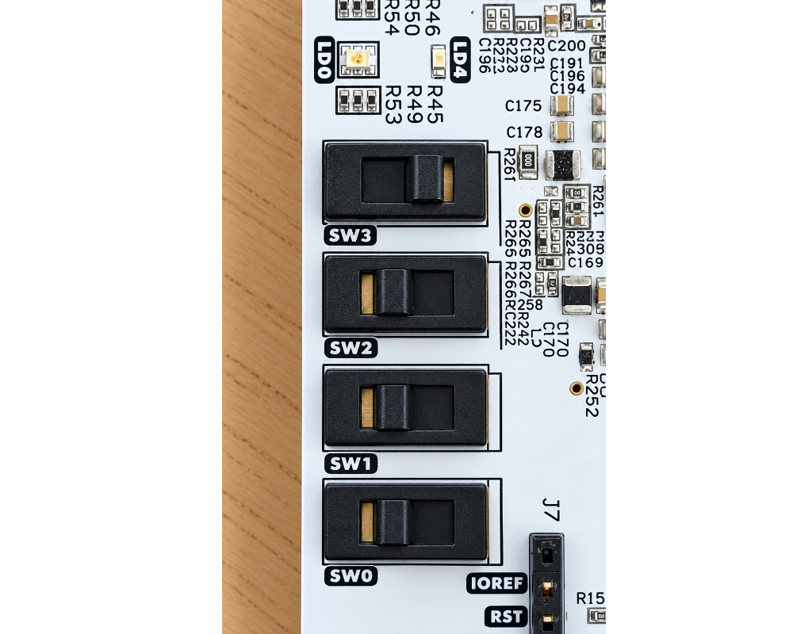

# BoxLambda Installation

To install BoxLambda:

1. [Install the prerequisites](prerequisites.md).
2. [Hook up the peripherals (PMODs)](pmods.md).
3. [Get the repository](#getting-the-repository).
4. [Set up the environment](#setting-up-the-environment).
5. [Activate the environment](#activating-the-tools-environment).
6. [Prepare the SD card](#preparing-the-sd-card).
7. [Set the Switches](#set-the-switches).
7. [Flash the bitstream, bootloader, and OS binary](#installing-the-boxlambda-base-bitstream-bootloader-and-os).

The first four steps should be executed once. Activating the environment is required every time you're working with BoxLambda.

## Getting the Repository

```
git clone https://github.com/epsilon537/boxlambda/
cd boxlambda
```

## Setting Up the Environment

The following script initializes the git submodules used and creates the default build trees:

```
source boxlambda_setup.sh
```

This script will:

- Initialize the git submodules.
- Install the required tools (compiler, oss-cad-suite, Bender...) if not already installed.
- Activate the OSS CAD Suite environment. This includes a Python environment.
- Install the required Python packages if not already installed.
- Update the PATH environment variable to include the required tools.
- Create the default build trees.

The script is easy to follow. The tool versions used are specified inside the script.

If you want to force a reinstall of the tools, delete the `./tools/` directory and source the `boxlambda_setup.sh` script again.

### User-Level Access to the Arty A7 USB JTAG Adapter.

When run at the user level, OpenOCD might not have permission to access the USB JTAG adapter. To fix this issue, add a rule to `/etc/udev/rules.d`.
Create a file named `99-openocd.rules` in the `/etc/udev/rules.d` directory. This file should have the following contents:

```
# Original FT2232 VID:PID
SUBSYSTEM=="usb", ATTRS{idVendor}=="0403", ATTRS{idProduct}=="6010", MODE="666", GROUP="plugdev"

```

### Serial Port

On my Linux system, when I plug in my Arty A7, the serial port shows up at `/dev/ttyUSB1`.

Serial Port Settings: **1000000 8N1**

## Activating the Tools Environment

When working with BoxLambda, its tools environment has to be activated. This is done by sourcing the `activate_env.sh` script.

```
source activate_env.sh
```

This script will:

- Check if the essential prerequisites (Vivado, RISC-V compiler) are installed.
- Activate the OSS CAD Suite environment. This includes a Python environment.
- Update the PATH environment variable to include the required tools.

If you have multiple BoxLambda workspaces, you only need to activate the tools environment in one of them.

To deactivate the environment again, enter `deactivate`.

## Preparing the SD card

Copy the contents of the `fs/` directory onto a FAT-formatted SD card. Insert the SD card into the
[MicroSD PMOD](pmods.md#microsd-pmod).

## Set the Switches

On the board, set switch 3 to the *on* position and switches 2-0 to the *off* position.

[](../assets/installation-switch-settings.png)

*Switch Settings.*

## Installing the BoxLambda Base Bitstream, BootLoader, and OS

### Option 1: Flashing the Release Binaries

The BoxLambda repo contains a `binaries/` subdirectory with release binaries. To flash those to the target:

Connect a terminal emulator to the Arty's USB serial port. **Settings: 1000000 8N1**.

From the repo root directory, navigate to the `binaries` subdirectory and flash the release bootloader image, the OS image, and the release bitstream image:

```
cd binaries
target.py -flash_bit boxlambda_base.bit
target.py -flash_boot bootloader.bin
target.py -flash_app boxkernforth.bin
target.py -reset
```

After completing the `target.py -reset` command, the target will be reset. In the terminal, you should first see the bootloader image, then the OS image booting up:

```
BoxLambda bootloader
--------------------
Version: vx.y.z
Initializing SDRAM...
Initializing SDRAM @0x20000000...
Switching SDRAM to software control.
Read leveling:
  m0, b00: |00000000000000000000000000000000| delays: -
  m0, b01: |11111111111111111111111111111100| delays: 14+-14
  m0, b02: |00000000000000000000000000000000| delays: -
  m0, b03: |00000000000000000000000000000000| delays: -
  m0, b04: |00000000000000000000000000000000| delays: -
  m0, b05: |00000000000000000000000000000000| delays: -
  m0, b06: |00000000000000000000000000000000| delays: -
  m0, b07: |00000000000000000000000000000000| delays: -
  best: m0, b01 delays: 14+-14
  m1, b00: |00000000000000000000000000000000| delays: -
  m1, b01: |11111111111111111111111111111100| delays: 14+-14
  m1, b02: |00000000000000000000000000000000| delays: -
  m1, b03: |00000000000000000000000000000000| delays: -
  m1, b04: |00000000000000000000000000000000| delays: -
  m1, b05: |00000000000000000000000000000000| delays: -
  m1, b06: |00000000000000000000000000000000| delays: -
  m1, b07: |00000000000000000000000000000000| delays: -
  best: m1, b01 delays: 14+-14
Switching SDRAM to hardware control.
Done.
Application image magic number check OK.
Application image size: 471500 bytes
Copying SW image from Flash to DDR...
Done.
Booting application image...
Initializing Forth...

Mecrisp-Quintus 1.1.1 for RISC-V RV32IM by Matthias Koch.
BoxLambda port by Ruben Lysens/Epsilon537.
Forth core init complete.
Mounting file system...
CID: 534d5402:47323341:7d604971:3168018d
sd0: mounted.
Boot path sd0:forth found.
No FatFS detected on ram:.
Booting from volume sd0:.
Loading forth/early.fs...
Redirecting stdio to Forth...
Initializing Forth Filesystem FFI...
Loading fastboot forth image...
Executing forth/init.fs...

     _
    ^-)
     (.._          .._
      \`\\        (\`\\        (
       |>         ) |>        |)
______/|________ (7 |` ______\|/_______a:f

Ready.

sd0:/>
```

You're now in the Forth REPL and can start entering Forth statements. [Try It Out](try-it-out.md).

### Option 2: Building and Loading from Source

I'm continuously modifying and testing the code. To avoid having to update the SD card and flash the binaries each time, I added a
mechanism that lets you:

1. load the bitstream and OS binary onto the device (without flashing)
2. load a RAM disk onto the device. At boot time, when the system detects the RAM disk, it will load the Forth modules from that RAM disk instead of the SD card.

#### Building and Flashing Bootloader

Application images and file systems can be loaded, but the bootloader has to be flashed onto the target (although you can use GDB to load the bootloader into RAM without flashing).

The following instructions show how to build and flash the bootloader:

```
cd build/arty-a7-100/sw/projects/bootloader
make bootloader
make bootloader_flash_sw
```

#### Building and Flashing or Loading Boxlambda_base Bitstream

```
cd build/arty-a7-100/gw/projects/boxlambda_base
make boxlambda_base.bit
```

This step will take a few minutes to complete. Once done, you can choose to
load the bitstream...:

```
make boxlambda_base_load
```

...or to flash it:

```
make boxlambda_base_flash_gw
```

#### Building and Flashing or Loading BoxLambda OS

```
cd build/arty-a7-100/sw/projects/boxlambda_os
make boxkernforth
```

To flash the OS binary:

```
make boxkernforth_flash_sw
```

To load the OS binary (instead of flashing):

```
make boxkernforth_load
```

To load the OS binary as well as the `fs/` target file system as a RAM disk:

```
make boxkernforthfs_load
```

