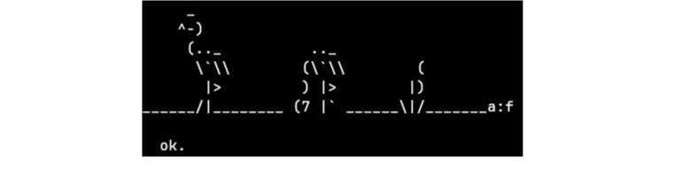
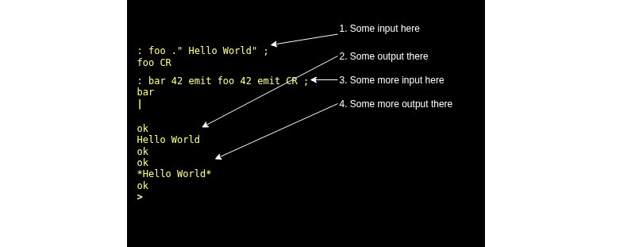

# BoxLambda OS Architecture

*BoxLambda OS Architecture Block Diagram.*

The two main subsystems are the BoxLambda Kernel (**BoxKern**) C environment and the Forth Environment.

The BoxKern image is stored in flash memory. The Bootloader loads the kernel into EMEM, then transfers control to it. The kernel's *CRT0* startup code then
further unpacks specific sections into EMEM and IMEM. (See [here](top-level-and-boot-seq.md) for a more detailed description of the boot sequence).

The BoxKern contains a Mecrisp Forth core and a pre-compiled Forth environment called **boxkern-includes**, set up at boot time. The Forth environment is further enhanced with Forth source code modules on the SD card and/or RAM disk file system.

## The BoxKern C Core

The BoxKern **C Core** contains C/C++ drivers, libraries, and C runtime. The C Core is mostly about leveraging existing non-Forth code, such as **FatFs**.
Key components include:

- **The Foreign Function Interface (FFI)**: This is the mechanism used to
call Forth from C code and C from Forth code. BoxKern drivers and libraries
export their functionality to the Forth environments through the FFI.
- **The Console Driver**: In the current BoxLambda code base, Picolibc's *stdin*
and *stdout* are associated with the serial port. This I/O method has to be
replaced by a Console Driver which forwards output to and takes input from the
Forth-side REPL.

## The Mecrisp Forth Core and Boxkern-Includes

The Mecrisp Forth Core is written in RISC-V assembly language. It contains Forth start-up code and definitions of key Forth words, such as interpreter/compiler words, that form the core of the Forth system. After
booting the Mecrisp Forth Core, you have a small, operational Forth system.

The Mecrisp Forth Core is complemented with the *BoxKern-Includes*, a set of pre-compiled Forth modules that are an essential part of the operating system. File system access and the graphics driver API, for instance, are part of the *boxkern-includes* list.

## The Forth Environment

*Mecrisp Forth's Welcome message - ASCII art from Adreas Freise.*

Most *new* code will be written in Forth or in assembly language in the Forth environment. Not everything in the Forth environment is new software, however. BoxLambda borrows much from existing Forth gems such as [Mecrisp Forth Quintus](https://mecrisp.sourceforge.net) and [ZeptoForth](https://github.com/tabemann/zeptoforth).

### The Canvas REPL / Editor

Instead of a line-oriented prompt, I would like to provide a REPL that allows
you to move freely all over the screen, as is the case on the Commodore 64, for
instance. The **Canvas REPL** can perform double duty as a text editor.

*The Canvas REPL.*

Note that the REPL takes its input from the USB HID keyboards and sends its
output to the attached VGA display. There is no serial port terminal.

### The BoxKern Proxies

The *BoxKern Proxies* are Forth-side proxies of BoxKern drivers and libraries. The
proxies access the BoxKern drivers/libs through the FFI.

# The Extras

The greyed-out parts in the block diagram are components that are not essential
to create a working system. These components are likely added later (some
possibly never). This is just a crude binary partitioning of what really
is an [iterative spiraling
approach](https://epsilon537.github.io/boxlambda/hello-world/). I start from
something small but working (e.g., the Mecrisp Forth core running in a serial port
terminal) and keep growing it. The greyed-out parts are among the parts to be
added last.

## Binary Executables and ELF Loader

Two such extra components are the *Binary Executables* and *ELF
Loader*. I would like to have a way to extend the non-Forth part of the system
without making the extension part of the kernel monolith. Lua, Lisp, or Smalltalk could be
added to the system in such a way, for example. These executables can
communicate with the rest of the system through the FFI.

# The Display

The 640x480 display is organized into two layers. The top layer is an 80x60
character grid displaying the Canvas REPL. The bottom layer is a 2-bit-per-pixel
640x480 bitmap. The *GFX Primitives* module will render to this layer by
default.

