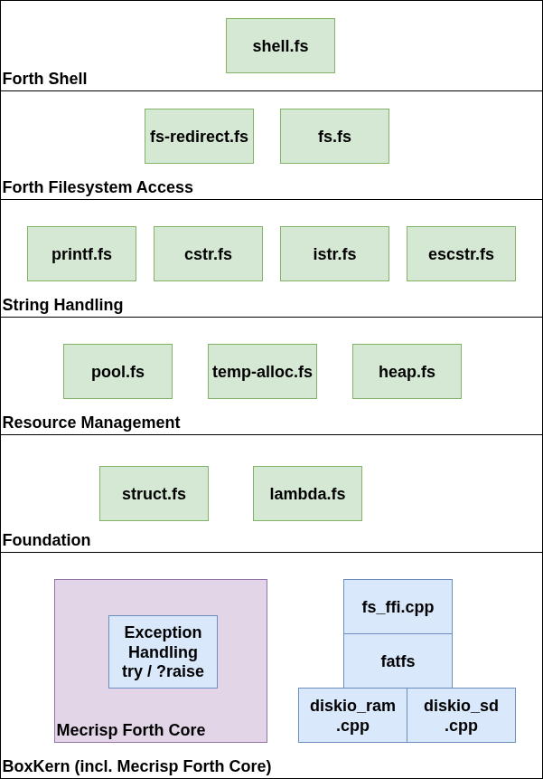
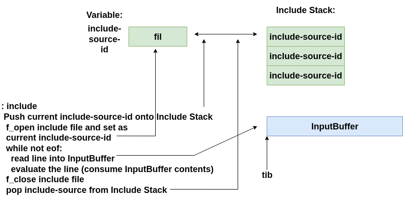

# The File System and Shell

The `fs/` directory in the Boxlambda repo is the root of the target filesystem. Its structure will evolve. Currently, it contains the following directories:

- `forth/` contains the system's `*.fs` Forth modules evaluated from source (by the application or `init.fs`) 
- `forth/boxkern-includes/` contains the BoxKern-Include modules. To speed up the boot procedure, these modules are compiled into the BoxKern executable rather than evaluated from source at runtime (see [BoxLambda OS Boot Sequence](top-level-and-boot-seq.md#boot-sequence)).
- `test/` contains test files used by the Forth test suite.
- `demos/` contains examples/demos. Execute them from the prompt using the following command: 

```
include /demos/<name-of-demo>.fs
```

Refer to the [Shell section](#shell) to see how to navigate the target file system from the Forth REPL.

Refer to the [Installation section](../../installation/installation.md) to see how to put the target file system on an SD card or on a target RAM disk.

## Forth Filesystem Stack

This diagram illustrates how the relevant Forth modules are stacked upon one another to attain Forth-level filesystem and shell access:

[](../../assets/fs-stack-layered.png)

*Forth Filesystem Stack.*

The Forth filesystem module `fs.fs` binds to FATFS via the [fs_ffi.cpp](../../../sw/components/forth/fs_ffi.cpp)
FFI module. See [here](c-ffi.md) for more info on the Forth-C FFI.

## Words

The file system access Words are based on those found in Peter Schmid's [Mecrisp Cube](https://github.com/spyren/Mecrisp-Cube/blob/master/sdcard/man/FileSystem.md) project.

### File system

[fs.fs](../../../fs/forth/boxkern-includes/fs.fs)

File Access:

`f_open ( addr len mode -- fil )`

- Open the file specified in the input string. The mode argument is a combination of the following values:
  - `FA_READ`: Specifies read access to the file. Data can be read from the file.
  - `FA_WRITE`: Specifies write access to the file. Data can be written to the file. Combine with FA_READ for read-write access.
  - `FA_OPEN_EXISTING`: Opens the existing file. The function fails if the file does not exist (default).
  - `FA_CREATE_ALWAYS`: Creates a new file and opens it. If the file already exists, it is truncated and overwritten.
  - `FA_CREATE_NEW`: Creates a new file. The function fails if the file already exists.
  - `FA_OPEN_ALWAYS`: Opens the file or creates a new one if it does not exist.
  - `FA_OPEN_APPEND`: Opens the existing file and sets the read/write pointer to the end of the file.

  May throw `x-fr-*` and `x-pool-*` exceptions.

`f_close ( fil -- )`

- Close file

`f_read ( fil buf numbytes -- numbytes )`

- Read n bytes from file into buffer
  May throw `x-fr-*` exception.
  May throw `x-fr-*` exception.

`f_write ( fil buf numbytes -- numbytes )`

- Write n bytes from buffer into file. May throw `x-fr-*` exception.

`f_lseek ( fil offset -- )`

- Moves the file read/write pointer of an open file. Can also be used to expand
  the file size (cluster pre-allocation).
  May throw `x-fr-*` exception.

`f_truncate ( fil -- )`

- Truncate file size to current read/write pointer. May throw `x-fr-*` exception.

`f_sync ( fil -- )`

- Flush cached data May throw `x-fr-*` exception.

`f_gets ( fil buf buflen -- adr len )`

- Read a string from the file.
  Note that reading from eof returns 0 0 as adr len.
  Note that when eof or buflen is reached,
  the returned line might not contain a \n.
  May throw `x-fr-*` exception.

`f_putc ( fil c -- )`

- Write a character to the file May throw `x-fr-*` exception.

`f_tell ( fil -- rwptr )`

- Get current read/write pointer.

`f_eof ( fil -- flag )`

- Test for end of file.

`f_size ( fil -- size )`

- Get file size.

`f_error ( fil -- flag )`

- Test for an error.

Directory Access:

`f_opendir ( addr len -- dir )`

- Open the directory specified in the input string. May throw `x-fr-*` and `x-pool-*` exceptions.

`f_closedir ( dir -- )`

- Close directory.

`f_readdir ( dir -- )`

- Read directory entry into the filinfo object. May throw `x-fr-*` exception. May throw `x-fr-*` exception.

`f_findfirst ( addr1 len1 addr2 len2 -- dir )`

- Open the directory specified in addr/len1 input string and read first
  item matching pattern specified in addr/len2 input string.
  Put result in filinfo object.
  May throw `x-fr-*` exception.
  See pattern-each for an easy-to-use wrapper around f_findfirst/next.

`f_findnext ( dir -- )`

- Find next entry matching pattern.
  Put result in filinfo object.
  May throw `x-fr-*` exception.

File and Directory Management:

`f_stat ( addr len -- )`

- Check existence of file or directory with given name. Put result in filinfo.
  May throw `x-fr-*` exception.

`f_unlink ( addr len -- )`

- Remove file or subdirectory with given name. May throw `x-fr-*` exception.

`f_rename ( addr1 len1 addr2 len2 -- )`

- Rename/move fil/dir in addr/len1 string addr/len2 string. May throw `x-fr-*` exception.

`f_chmod ( addr len attr mask -- )`

- Change attribute of file or directory with given name.
  Attribute values: `AM_RDO`, `AM_ARC`, `AM_SYS`, `AM_HID`
  May throw `x-fr-*` exception.

`f_utime ( addr len -- )`

- Change timestamp (time and date) of file or subdirectory with given name to value specified in filinfo.
  May throw `x-fr-*` exception.

`filinfo` is a global object, populated by directory operations. The following Words are the object's accessors:

- `filinfo.fsize ( -- fsize )` Retrieve file size from global filinfo object.

- `filinfo.setfdate ( dd mm yyyy -- )` Set date in global filinfo object.

- `filinfo.getfdate ( -- dd mm yyyy )` Retrieve date from global filinfo object.

- `filinfo.setftime ( hh mm ss -- )` Set time in global filinfo object.

- `filinfo.getftime ( -- hh mm ss )` Retrieve time from global filinfo object.

- `filinfo.fattrib ( -- attrib )` Retrieve attributes from global filinfo object: `AM_RDO, AM_ARC, AM_SYS, AM_HID, AM_DIR.`

- `filinfo.fname ( -- c-addr len )` Retrieve name from global filinfo object.

`f_mkdir ( addr len -- )`

- Make directory with given name. May throw `x-fr-*` exception.

`f_chdir ( addr len -- )`

- Change current directory to directory with given name. May throw `x-fr-*` exception.

`f_getcwd ( -- addr len )`

- Return current working directory name.
  The given string object remains valid until the next `f_*` operation.
  May throw `x-fr-*` exception.

`f_cmp ( addr0 len0 addr1 len1 -- f )`

- Compare two files, identified by filename. Pushes true if identical, false otherwise.

`glob-each ( pata patl xt -- )`

- Iterate over each file matching given glob pattern string, invoke xt passing in full file path.

Example:

```
: rm
  cr
  token
  [: ( patha pathl )
    2dup s" Removing: %s" printf cr ( patha pathl )
    f_unlink ( dir )
  ;] ( pata patl xt )
  glob-each
;
```

Volume Management and System Configuration:

`f_mount ( addr len -- )`

- Mount a volume. Pass in volume name, e.g. `s" ram:"`, or `s" sd0:"`. May throw `x-fr-*` exception.

`f_umount ( addr len -- )`

- Unmount a volume. Pass in volume name, e.g. `s" ram:"`, or `s" sd0:"`. May throw `x-fr-*` exception.

`f_chdrive ( addr len -- )`

- Change drive. Pass in volume name, e.g. `s" ram:"`, or `s" sd0:"`. May throw `x-fr-*` exception.

`f_getfree ( addr len -- tot free )`

- Get total and free bytes on volume.
  Pass in volume name, e.g. `s" /ram"`, or `s" /sd"`
  May throw `x-fr-*` exception.

Pathname accessors:

`dirname ( addr len -- addr len )`

- Extract the directory name portion of a path string:

`basename ( addr len -- addr len )`

- Extract the basename portion of a path string:

`pathname ( dira dirl basa basl buf -- patha pathl )`

- Combine a directory name and a basename into a full path name.

`ior>exception ( ior -- xt)`

- FATFS IO result (`FRESULT`) to exception mapping.

`check-throw-ior ( ior -- )`

- Check FatFS IO result and throw exception if non-zero.

`.ior ( ior -- )`

- Print the IO return code string.

Exceptions:

```
x-fr-disk-err
x-fr-int-err
x-fr-not-ready
x-fr-no-file
x-fr-no-path
x-fr-invalid-name
x-fr-denied
x-fr-exist
x-fr-invalid-object
x-fr-write-protected
x-fr-invalid-drive
x-fr-not-enabled
x-fr-no-filesystem
x-fr-mkfs-aborted
x-fr-timeout
x-fr-locked
x-fr-not-enough-core
x-fr-too-many-open-files
x-fr-invalid-parameter
x-fr-unknown
```

### Output Redirection to File

[fs-redirect.fs](../../../fs/forth/boxkern-includes/fs-redirect.fs)

`emit>file ( fil -- )`

- Set emit-hook and emit-hook? to emit-to-open-file handlers.

`emit>console ( -- )`

- Set emit-hook and emit-hook? to console handlers.

`emit>null ( -- )`

- Set emit-hook and emit-hook? to drop all output.

`tee>file ( fil -- )`

- Set emit-hook and emit-hook? to emit-to-open-file-and-console handlers.
  Install emit hook forwarding to open file with given description,
  then invoke previous emit handler.

`tee-end ( -- )`

- Remove `tee>file` emit hook. Restore previous emit handler.

### Shell

[shell.fs](../../../fs/forth/boxkern-includes/shell.fs)

Some basic shell-like commands for interactive use.

`ls ( "glob-pattern" -- )`

- ls with glob pattern string: `ls ./*.fs` , `ls ../*`.

`mkdir ( "dirname" -- )`

- Make directory. `mkdir <dirname>`.

`cd ( "dirname" -- )`

- Change directory. `cd <dirname>`.

`pwd ( -- )`

- Print working directory.

`chmod ( "glob-pattern" "+/-attrib" -- )`

- `chmod <fname> +/-<attrib>`. e.g. `chmod dir/file.* -rdo`.

`mv ( "from" "to" -- )`

- `mv <source-file> <dest-file>`
- `mv <source-file> <dest-dir>`
- `mv <source-pattern> <dest-dir>`
- `*` and `?` are wildcards in the pattern string.

`cp ( "from" "to" -- )`

- `cp <source-file> <dest-file>`
- `cp <source-file> <dest-dir>`
- `cp <source-pattern> <dest-dir>`
- `*` and `?` are wildcards in the pattern string.

`cat ( "filename" -- )`

- Print the contents of the given text file.

`fdump ( "filename" -- )`

- Hex dump the given file.

`rm ( "pattern" -- )`

- `rm <file or dir pattern string>`, e.g. `rm dir/*.txt`
  `\` `*` and `?` are wildcards in the pattern string.

`chdrv ( "volume" -- )`

- Change drive. Supported volumes are `sd0:` and `ram:`

`umount ( "volume" -- )`

- Unmount a volume. Supported volumes are `sd0:` and `ram:`

`mount ( "volume" -- )`

- Mount a volume. Supported volumes are `sd0:` and `ram0:`

`df ( "volume" -- )`

- Get volume usage info. Supported volume names are `sd0:` and `ram0:`

`>null ( xt -- )`

- Execute xt with all output suspended.
  Usage: `[: <statements to be executed with output suspended :] >null`

`>file ( xt "filename" -- )`

- Redirect stdout to given file in overwrite mode. Don't emit to console.
  Usage: `[: <statements to be executed with redirection ;] >file file.log`

`&>file ( xt "filename -- )`

- Redirect stdout to given file in overwrite mode and emit to console.
  Usage: `[: <statements to be executed with redirection ;] tee>file file.log`

`>>file ( xt "filename" -- )`

- Redirect stdout to given file in append mode. Don't emit to console.
  Usage: `[: <statements to be executed with redirection ;] >>file file.log`

`include ( any "path" -- any )`

- Load and evaluate forth code from a file with the given path.
  `include` may be used recursively, i.e., an included file
  may contain one or more include calls.
  May raise `x-line-truncated`.

- See [Include File Evaluation](#include-file-evaluation).

`refill ( -- )`

- An alternative query that also supports input
  from file. The file id is indicated in variable
  `include-source-id`. If set to 0, `refill` invokes
  `query`.
  May raise `x-line-truncated` and `x-eof`.

Exceptions:

```
x-eof
x-line-truncated
```

## Include File Evaluation

This diagram shows how the `include` Word works:


[](../../assets/include-file-evaluation.png)

*Forth Include File Evaluation.*

The above refers to the regular Forth `include` Word, defined in [shell.fs](../../../fs/forth/boxkern-includes/shell.fs). The BoxKern also provides a way
to load and evaluate Forth modules from C code. This mechanism is discussed in [the BoxKern-Includes Mechanism](top-level-and-boot-seq.md#the-boxkern-includes-mechanism).

