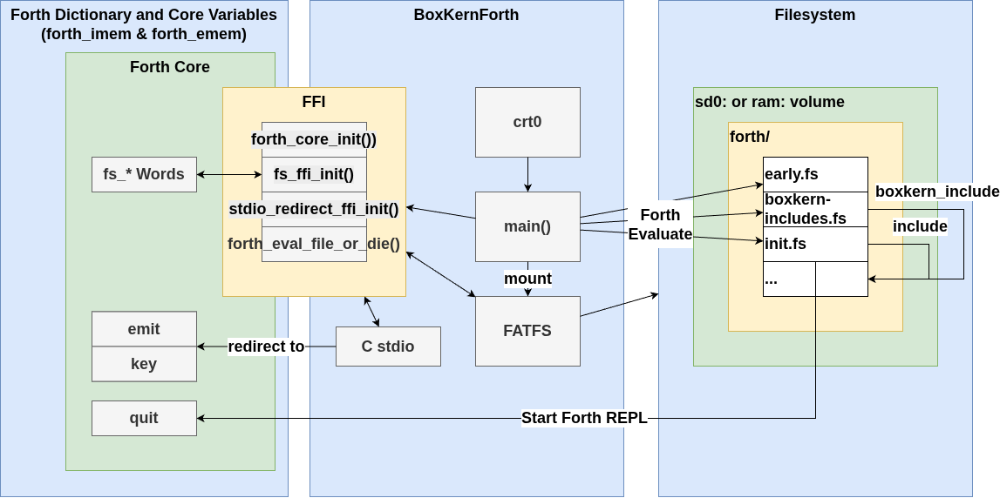
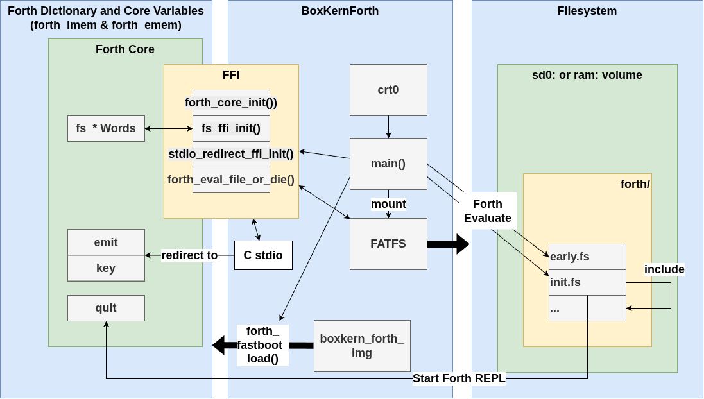
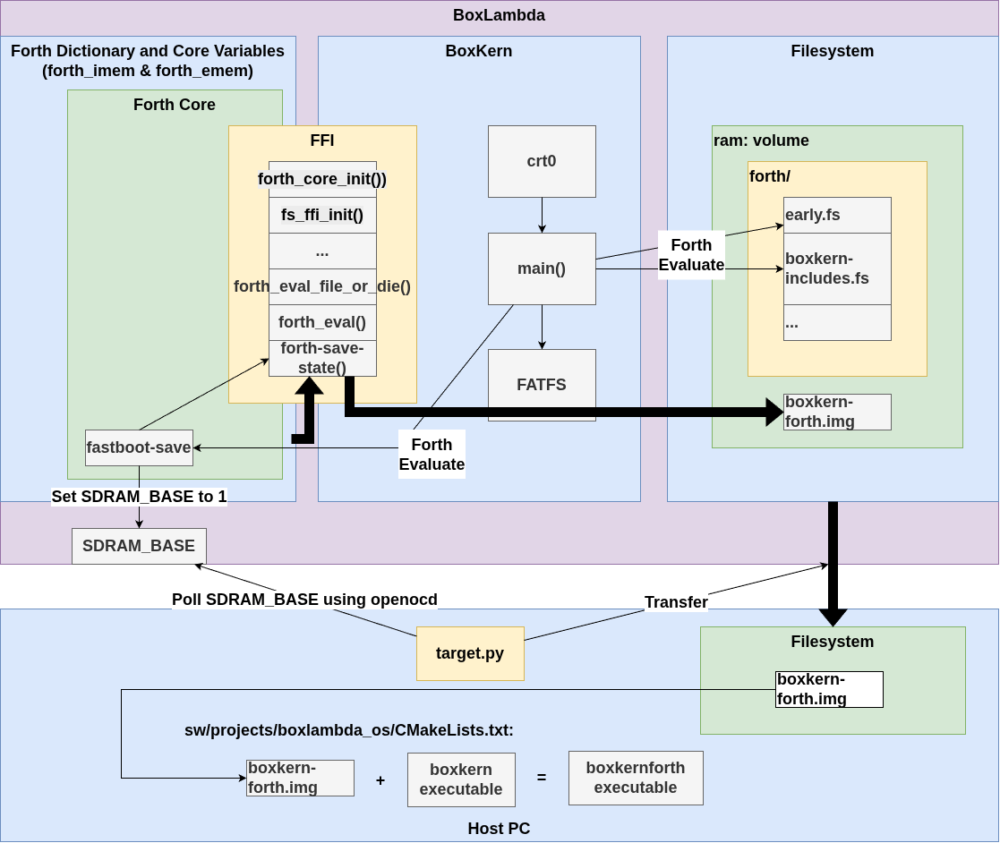

# BoxLambda OS Top-Level

**BoxLambda OS Software Project top-level in the BoxLambda Directory Tree**: [sw/projects/boxlambda_os](../../../sw/projects/boxlambda_os/)

## Boot Sequence

After the Bootloader has transferred control to the OS image it has loaded into EMEM, the OS start-up code goes through the following sequence:

1. `crt0.c` sets up a basic C environment as described in the [early software startup sequence](../base-platform/bootstrap/bootstrap.md#early-software-startup-sequence).
2. `main()` performs the following steps:
    1. Initialize Forth by calling `forth_core_init()`.
    2. Find and mount a filesystem boot volume:
        1. Attempt to mount the SD card volume `sd0:` and the RAM disk volume `ram:`.
        2. Search for a `ram:/forth/` directory. If found, `ram:` is set as the Forth boot volume.
        3. If `ram:/forth/` is not found, search for a `sd0:/forth` directory. If found, `sd0:` becomes the Forth boot volume.
        4. If neither `ram:/forth` nor `sd0:/forth` is found, `main()` prompts the user to insert an SD card or to upload a RAM disk containing the target filesystem.
    3. Evaluate Forth module [fs/forth/early.fs](../../../fs/forth/early.fs). This module contains some early definitions extending the core Word set. Currently, only the Word `c-fun` is defined here.
    5. Redirect the C library's stdio to Forth's `emit` and `key` Words. See [stdio_redirect.cpp](../../../sw/components/forth/stdio_redirect_ffi.cpp).
    6. Initialize the Forth<->C Filesystem Foreign Function Interface (FFI). See [fs_ffi.cpp](../../../sw/components/forth/fs_ffi.cpp).
    7. Check the [Fast-Boot switch](../../leds-and-switches.md#switches). If set, execute the *Fast Boot* sequence, otherwise, perform a *Slow Boot*. Fast Boot and Slow Boot are described in the following two subsections.

### Slow Boot

1. Evaluate the Forth modules listed in [fs/forth/boxkern-includes.fs](../../../fs/forth/boxkern-includes/boxkern-includes.fs).
2. Transfer control to Forth by evaluating [fs/forth/init.fs](../../../fs/forth/init.fs). `init.fs` is expected to invoke the `quit` Word, starting the Forth REPL.

*The BoxLambda OS Slow Boot Sequence.*

### Fast Boot

1. Copy the pre-compiled `boxkern_forth_img` into place, instantly populating the Forth dictionary with all the Words from the [boxkern-includes](../../../fs/forth/boxkern-includes/boxkern-includes.fs) modules.
2. Transfer control to Forth by evaluating [fs/forth/init.fs](../../../fs/forth/init.fs). `init.fs` is expected to invoke the `quit` Word, starting the Forth REPL.

*The BoxLambda OS Slow Boot Sequence.*

### Generating boxkern_forth.img

The `boxkkern_forth_img`, used during Fast Boot, is generated by performing a Slow Boot and recording the resulting Forth state (dictionary and core variables):

1. `main()` performs a Slow Boot.
2. Instead of including `init.fs`, `main()` invokes the [fastboot-save](../../../fs/forth/boxkern-includes/fastboot.fs) Word.
3. `fastboot-save` saves the Forth state (`forth_imem` and `forth_emem`) to a file called `boxkern_forth.img`.
4. `fastboot-save` sets the `SDRAM_BASE` memory location to 1, signalling to the `target.py` process running on the host PC that the `boxkern_forth.img` is ready for retrieval.
5. `target.py` transfers the target filesystem to the host PC and extracts `boxkern_forth.img`.
5. The build system links the `boxkern_forth.img` into the Fast Boot BoxKern executable `boxkernforth`.

*Generating boxkern_forth.img.*

## The BoxKern-Includes Mechanism

[fs/forth/boxkern-includes.fs](../../../fs/forth/boxkern-includes/boxkern-includes.fs) may look like a Forth module, but it's not.

The syntax is limited to lines starting with `\`, which are ignored, and lines beginning with the word `boxkern_include` followed by the full path of an `.fs` Forth module to be evaluated. These Forth modules must not include any submodules themselves.

The BoxKern loads and passes `boxkern_include` files to the Forth environment at boot time using [Forth-C FFI function](c-ffi.md)  `forth_eval_boxkern_includes_or_die()`. This mechanism allows a limited form of Forth module loading until the Forth `include` Word can be defined. The order of the modules listed in `boxkern-includes.fs` is important because new Words build upon previously defined Words. The modules in `boxkern-includes.fs` build up a stack, with [shell.fs](../../../fs/forth/boxkern-includes/shell.fs) on top.

## Words

[fastboot.fs](../../../fs/forth/boxkern-includes/fastboot.fs)

`fastboot-save ( -- )`

- Fastboot helper Word: Save forth imem and emem up to `here` to file `boxkern-forth.img`. See [Generating boxkern_forth.img](#generating-boxkern_forthimg).

