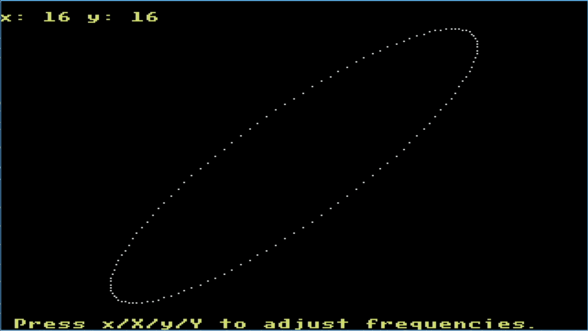
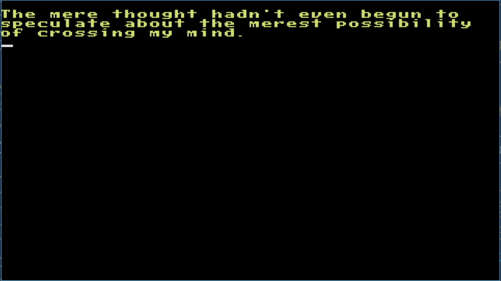
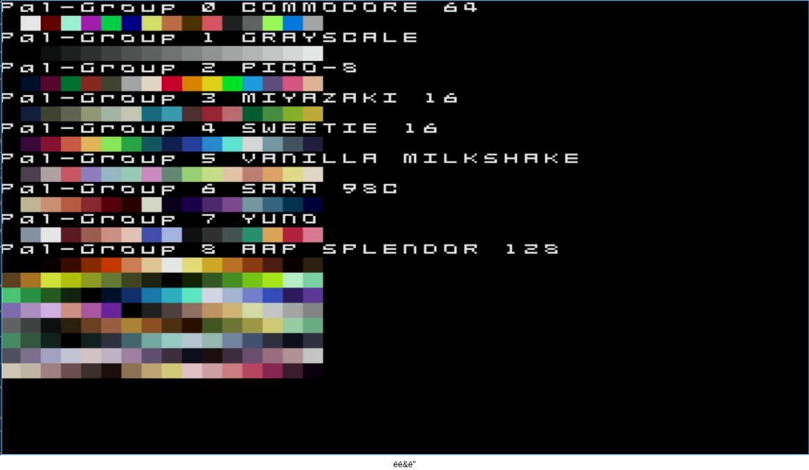

# Try It Out

From the Forth REPL, try `ls`, `cd`, and `cat` to navigate around the file system and look at files:

```
sd0:/> ls *

00000000 2026/10/17 10:34:26 --- --- --- --- DIR --- test
00000000 2026/10/17 10:34:32 --- --- --- --- DIR --- forth
00000000 2026/10/17 10:34:32 --- --- --- --- DIR --- demo

sd0:/> cd forth

sd0:/forth> ls *

00000335 2026/05/12 10:07:42 --- --- --- --- --- ARC early.fs
00020441 2026/05/12 10:07:42 --- --- --- --- --- ARC fixpt-math-lib.fs
00000490 2026/05/12 10:07:42 --- --- --- --- --- ARC irq.fs
00000452 2026/05/12 10:07:42 --- --- --- --- --- ARC trace.fs
00004558 2026/10/16 13:01:34 --- --- --- --- --- ARC uart_regs.fs
00000947 2026/10/16 13:01:34 --- --- --- --- --- ARC reset_regs.fs
00002466 2026/10/16 13:01:34 --- --- --- --- --- ARC gpio_regs.fs
00001373 2026/10/16 13:01:34 --- --- --- --- --- ARC mtimer_regs.fs
00001562 2026/10/16 13:01:34 --- --- --- --- --- ARC i2c_master_regs.fs
00003661 2026/10/16 13:01:34 --- --- --- --- --- ARC usb_hid_regs.fs
00002495 2026/10/16 13:01:36 --- --- --- --- --- ARC sdspi_regs.fs
00000522 2026/10/16 13:01:36 --- --- --- --- --- ARC spiflash_regs.s
00014902 2026/10/16 13:01:36 --- --- --- --- --- ARC ym2149_regs.fs
00007007 2026/10/16 13:01:36 --- --- --- --- --- ARC dfx_controller_other_regs.fs
00000924 2026/10/16 13:01:38 --- --- --- --- --- ARC dfx_controller_ctrl_reg.fs
00000000 2026/10/17 10:34:32 --- --- --- --- DIR --- boxkern-includes
00002499 2026/10/07 14:23:40 --- --- --- --- --- ARC font-loader.fs
00002376 2026/10/16 13:01:36 --- --- --- --- --- ARC vera_spr_attr_ram.fs
00002269 2026/10/16 15:07:44 --- --- --- --- --- ARC init.fs

sd0:/forth>
sd0:/forth> cat irq.fs

\ Setting the MTIMER Comparator
: set-raw-time-cmp ( u -- ) s>d mtime64 d+ mtimecmp64! ;

\ IRQ ID constants
16 constant irq-id-fast-0
7 constant irq-id-timer
13 irq-id-fast-0 + constant irq-id-vera
12 irq-id-fast-0 + constant irq-id-vs00
08 irq-id-fast-0 + constant irq-id-dfx
10 irq-id-fast-0 + constant irq-id-sdpsi
08 irq-id-fast-0 + constant irq-id-usb-hid-1
07 irq-id-fast-0 + constant irq-id-usb-hid-0
07 irq-id-fast-0 + constant irq-id-i2c
05 irq-id-fast-0 + constant irq-id-uart

sd0:/forth>
```

Create a `hello-world.fs` module and transfer it to the target:

- In a linux terminal, navigate to the `fs/test` directory and create a `hello-world.fs` file with contents `: hello-world ." Hello World." cr ;`:

```
$ cd fs/test
fs/test$ echo ": hello-world .\" Hello World.\" cr ;" > hello-world.fs
```

- Transfer the `fs/` directory, including the new `hello-world.fs` file, to the target as a RAM disk:

```
/fs/test$ cd ../..
$ target.py -load_fs fs
=== Target Control ===
Uploading dir as RAM disk: fs
...
Loading Filesystem image...
Done.
```

- On the target, navigate to `ram:/test`, source the `hello-world.fs` file, and execute the `hello-world` Word it created:

```
sd0:/forth> chdrv ram:

ram:/> cd test

ram:/test> ls *
...
00000036 2026/04/21 19:33:52 --- --- --- --- --- ARC hello-world.fs
...
ram:/test> include hello-world.fs

ram:/test> hello-world
Hello World.

ram:/test>
```

## Examples/Demos

Below are a few basic examples illustrating different aspects of the VERA graphics subsystem. A VGA display must be hooked up to see these demos (see [here](pmods.md#vga-pmod)).

- [Lissajous Animation](https://github.com/epsilon537/boxlambda/blob/develop/fs/demo/lis-demo.fs): Run the following command from the Forth prompt to start this demo:

```
include demo/forth/lis-demo.fs
```

[](../assets/lis-demo.png)

*The VERA Lissajous Animation Demo.*

- [Text Mode Demo](https://github.com/epsilon537/boxlambda/blob/develop/fs/demo/vera-txt-demo.fs): Run the following command from the Forth prompt to start this demo:

```
include demo/forth/vera-txt-demo.fs
```

[](../assets/vera-txt-demo.png)

*The VERA Text Mode Demo.*

- [VERA Palette Demo](https://github.com/epsilon537/boxlambda/blob/develop/fs/demo/vera-pal-demo.fs): Run the following command from the Forth prompt to start this demo:

```
include demo/forth/vera-pal-demo.fs
```

[](../assets/vera-pal-demo.png)

*The VERA Palette Demo.*

