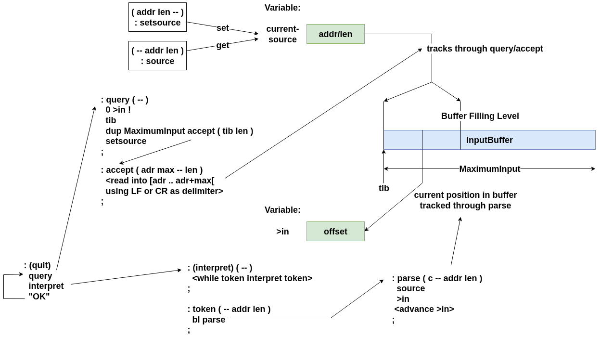

# Interpreting Console Input

The following diagram illustrates the Forth core interpreting console input:

*Forth Core Interpreting Console Input.*

## Words

[query.s](https://github.com/epsilon537/boxlambda/blob/v0.5.0/sw/components/forth/query.s)
[token.s](https://github.com/epsilon537/boxlambda/blob/v0.5.0/sw/components/forth/token.s)
[interpreter.s](https://github.com/epsilon537/boxlambda/blob/v0.5.0/sw/components/forth/interpreter.s)
[on-quit.fs](https://github.com/epsilon537/boxlambda/blob/v0.5.0/fs/forth/boxkern-includes/utils.fs)
[prompt.fs](https://github.com/epsilon537/boxlambda/blob/v0.5.0/fs/forth/boxkern-includes/prompt.fs)

`query ( -- )`

- Fetches user input to input buffer.

`tib ( -- cstr-addr )`

- Input buffer.

`current-source ( -- addr )`

- Double variable which contains source.

`setsource ( c-addr len -- )`

- Change source.

`source ( -- c-addr len )`

- Current source.

`>in ( -- addr )`

- Variable with current offset into source.

`accept ( c-addr maxlength -- length )`

- Read input into a string.

`token ( -- c-addr len )`

- Cuts one token out of input buffer.

`parse ( char -- c-addr len )`

- Cuts anything delimited by char out of input buffer.

`evaluate ( any addr len -- any )`

- Interpret given string.

`interpret ( any -- any )`

- Execute, compile, fold, optimize...

`hook-interpret ( -- a-addr )`

- Hook for changing the interpreter implementation.

`(interpret) ( -- )`

- The Mecrisp Forth interpreter implementation.

`(interpret-w-except-trace) ( -- )`

- Wrapper around Mecrisp Forth's `(interpret)` that prints which Word triggered the exception when an uncaught exception occurs (see [Forth Exceptions](exception-handling.md)).

`quit ( many -- ) (R: many -- )`

- Enter the REPL. Resets Stacks.

`hook-quit ( -- a-addr )`

- Hook for changing the inner quit loop.

`(quit) ( any -- any )`

- Original Mecrisp Forth REPL.

`hook-on-quit ( -- a-addr )`

- Hook in here any clean-up etc. that needs to happen whenever quit is invoked. The custom quit-hook in `prompt.fs` will invoke this chain before entering the quit loop. This variable is defined early in the include list to allow early `boxkern-includes` to install their on-quit hooks (see [compileto.fs](https://github.com/epsilon537/boxlambda/blob/v0.5.0/fs/forth/boxkern-includes/compileto.fs) for example).

`quit_w_cwd ( -- )`

- A quit loop that invokes the on-quit hook and prints the current working directory as a prompt. Installed into `hook-quit` during start-up.

